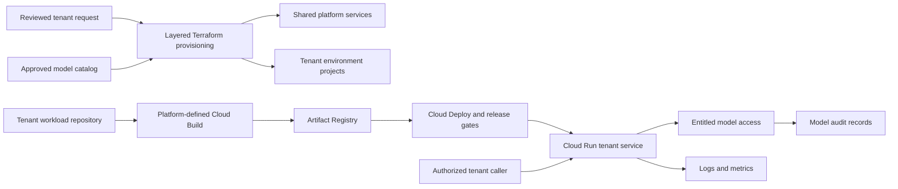
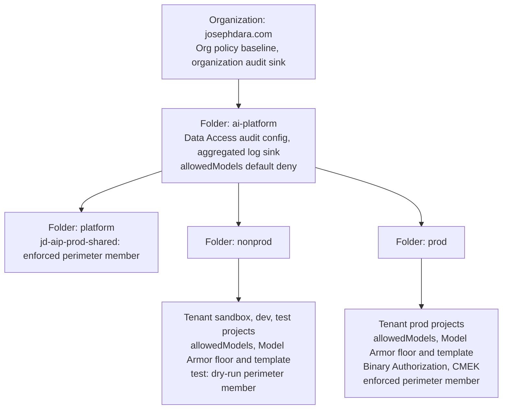
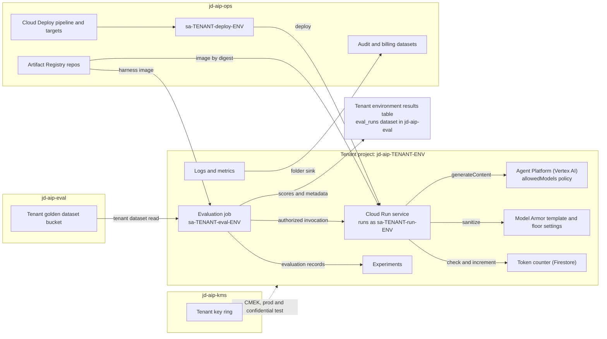
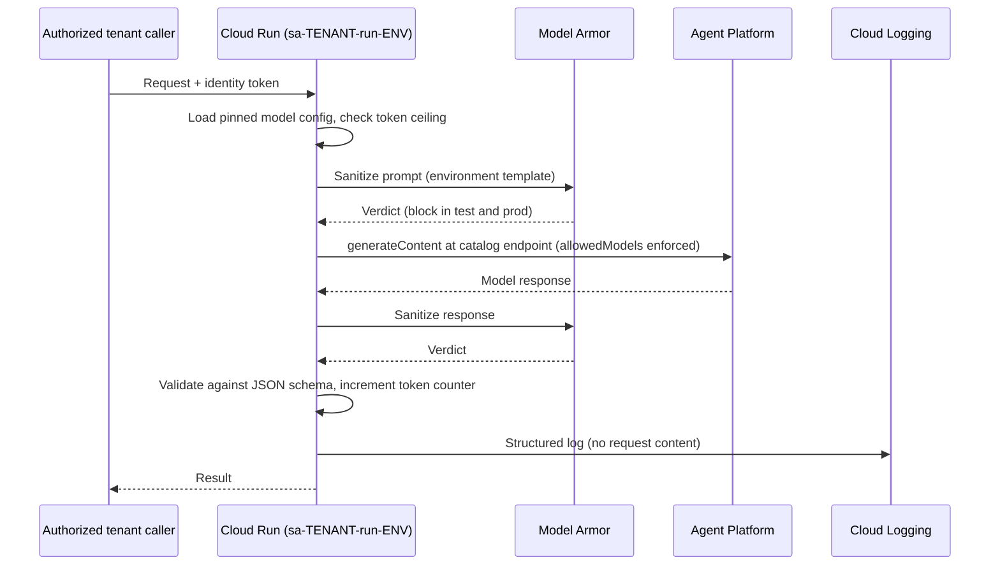
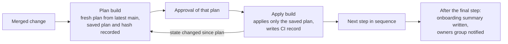
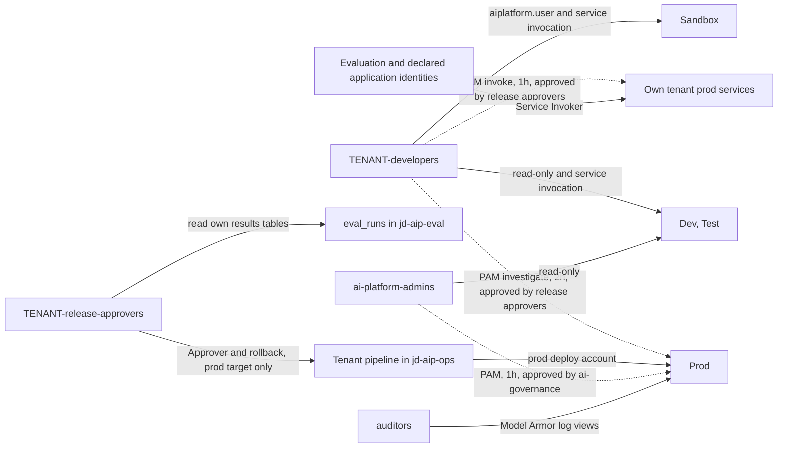
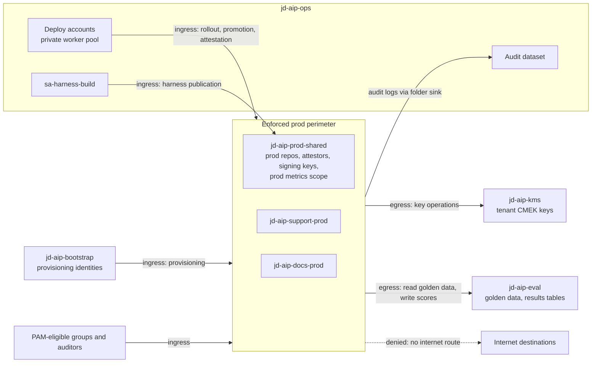

# TenantLoom AI Architecture

| Field | Value |
|---|---|
| Owner | Joseph Olutimehin |
| Status | Planned. Design decisions are settled; nothing is implemented or verified. |
| Build plan | TenantLoom AI |
| Organization | `josephdara.com` (Cloud Identity Free) |
| Primary region | `us-east4` |
| Model endpoint | Agent Platform `us` multi-region for current Gemini models (section 7) |

This document describes the target architecture for TenantLoom AI. Everything below captures intended behavior. A capability counts as demonstrated only when supporting evidence records the observed result (see [Verification and evidence boundaries](#18-verification-and-evidence-boundaries)). Platform behavior that must be confirmed in the lab before a control is relied on is listed under [Implementation verification](#17-implementation-verification).

**Values to replace.** The domain, organization and billing identifiers, `jd-aip-` project IDs, group addresses, notification addresses, and region are the owner's planned values. Anyone reproducing the architecture must substitute their own.

**Naming.** Google now calls the model platform Gemini Enterprise Agent Platform; it was previously named Vertex AI. This document writes "Agent Platform (Vertex AI)" for the platform and keeps the identifiers that APIs, roles, service agents, and policies still use, such as `aiplatform.googleapis.com`, `roles/aiplatform.*`, and `vertexai.allowedModels`. Model availability, endpoints, and service support change over time and are rechecked whenever a catalog entry is created.

## 1. Purpose and scope

TenantLoom AI is an internal GCP platform that provisions governed access to Gemini and Model Garden models for application teams. A platform team owns shared infrastructure, guardrails, delivery templates, and the model catalog. Each application team is a tenant that requests environments, model access, and budgets through pull requests. An approved request drives layered Terraform automation from a common definition: a project factory creates the tenant's projects and their contents, while platform and organization layers create the tenant's objects in shared projects, its model access policies, and its budget. The target is repeatable onboarding with no manual tenant setup beyond approvals, once the platform foundation exists.

Two planned pilot tenants exercise the architecture:

| Tenant | Workload | Purpose |
|---|---|---|
| `team-docs` | `extract-api` on Cloud Run | Extract structured fields from document text using Gemini |
| `team-support` | Ticket summarization service on Cloud Run | Summarize tickets using the shared starter template |

### Design goals

| Area | Goal |
|---|---|
| Provisioning | An approved tenant request becomes fully configured environments with no manual steps |
| Environments | Sandbox, dev, test, and prod for every tenant, from the same modules, with controls that tighten toward prod |
| Governance | Org-wide model catalog, per-tenant entitlements enforced by org policy, data classification and retention, central audit logging, per-tenant showback |
| Access | Group-based IAM, tenant isolation, least-privilege service accounts, no standing human roles on prod projects (auditor read access to restricted Model Armor log views is the one recorded exception), release approval through Cloud Deploy, time-bound elevation through Privileged Access Manager (PAM) |
| Workflows | Request workflows for onboarding, model access, and budgets; one promotion pipeline every tenant inherits |
| MLOps | Shared evaluation service, version pinning, experiment tracking, prod quality monitoring, model upgrade process |
| Security | VPC Service Controls, Model Armor, CMEK, Binary Authorization, keyless authentication, written threat model |

## 2. Operating model and ownership

The architecture separates platform provisioning, tenant delivery, and runtime inference.

| Role | Group | Responsibility |
|---|---|---|
| Platform team | `ai-platform-admins` | Org hierarchy, bootstrap, shared projects, Terraform modules, policies, perimeters, logging, billing export, catalog, templates, mandatory release checks, and minimum quality thresholds. Works through Terraform only. |
| Governance reviewers | `ai-governance` | Onboarding approval, catalog additions, model entitlements, budget increases above the platform limit, offboarding approval |
| Tenant teams | `<tenant>-developers`, `<tenant>-release-approvers` | Application code, prompts, datasets, runtime configuration, eval thresholds, prod releases, workload incidents |
| Auditors | `auditors` | Audit data, restricted Model Armor logs, and access review findings across tenants |

- **Platform-owned:** platform projects, org policies, model catalog, perimeters, log sinks, billing export, Terraform modules, templates, the gate bundle, and build configuration.
- **Tenant-owned:** workload code, prompts, golden datasets, thresholds at least as strict as platform minimums, runtime configuration, and prod release approval.

Platform resources change only through reviewed Terraform. Tenant workloads deploy through the standard pipeline. Sandbox permits console, notebook, and CLI experimentation within its guardrails; other environments change only through delivery and provisioning workflows.



This is a logical view. Sections 9 and 10 define the IAM and service perimeter design behind each arrow.

### Platform services (what every tenant receives)

| Service | Contents |
|---|---|
| Tenant environments | Sandbox, dev, test, prod projects with baseline policies, labels, logging, and a tenant budget |
| Model access | Catalog models entitled to the tenant, scoped per environment |
| Delivery pipeline | Cloud Deploy pipeline, platform-defined Cloud Build triggers, Artifact Registry repositories |
| Evaluation service | Centrally maintained harness, tenant-local evaluation jobs and identities, Gen AI evals, Experiments, central eval reporting |
| Security baseline | Model Armor screening, prod perimeter membership, CMEK, Binary Authorization |
| Observability | Dashboards, SLO templates, alerts routed to the tenant channel |
| Showback | Monthly cost by tenant, environment, and model |
| Starter template | Cloud Run plus Gemini service wired to the pipeline, gates, Model Armor screening, token ceiling, and logging standards |

## 3. Resource hierarchy

Environment folders group projects by control requirements. Tenants are identified by projects, labels, groups, and service accounts, not by tenant folders (ADR-001).

```text
josephdara.com (organization, Cloud Identity Free)
└── ai-platform (folder)
    ├── platform (folder)
    │   ├── jd-aip-bootstrap
    │   ├── jd-aip-ops
    │   ├── jd-aip-eval
    │   ├── jd-aip-kms
    │   └── jd-aip-prod-shared
    ├── nonprod (folder)
    │   ├── jd-aip-docs-sandbox     jd-aip-docs-dev     jd-aip-docs-test
    │   └── jd-aip-support-sandbox  jd-aip-support-dev  jd-aip-support-test
    └── prod (folder)
        ├── jd-aip-docs-prod
        └── jd-aip-support-prod
```

| Shared project | Planned contents |
|---|---|
| `jd-aip-bootstrap` | Terraform state buckets for platform and tenant state, provisioning identities (`sa-org`, `sa-platform`, `sa-factory`, and read-only plan identities), infrastructure CI, the saved plan bucket, the CI apply lock bucket, and the CI records dataset |
| `jd-aip-ops` | Workload CI (Cloud Build for tenant builds, with a private worker pool for prod rollouts), Cloud Deploy, per-tenant nonprod Artifact Registry repositories, the harness repository, per-tenant delivery accounts, the `built-by-cloud-build` attestor, the central audit dataset, the billing export dataset, the access review and showback datasets, and the nonprod metrics scope |
| `jd-aip-eval` | Catalog and candidate model evaluation jobs, tenant golden dataset buckets, the `eval_runs` dataset with one results table per tenant environment, and temporary self-deployed evaluation endpoints. Tenant workload evaluations execute in their respective tenant environment projects. |
| `jd-aip-kms` | Per-tenant key rings and CMEK keys |
| `jd-aip-prod-shared` | Inside the enforced prod perimeter. Per-tenant prod Artifact Registry repositories, the platform prod harness repository, per-tenant prod Binary Authorization attestors with their Cloud KMS signing keys, prod attestations, and the prod metrics scope |

Org and folder policies set the common baseline and are inherited by new projects, including a default on the `ai-platform` folder that denies all models until a project's own model policy is applied. Project-level IAM and model policies set tenant-specific access. Perimeter membership is not inherited: the platform layer generates the enforced perimeter's membership from tenant prod projects and `jd-aip-prod-shared`, and the dry-run perimeter's membership from tenant test projects, based on the tenant files.

Each tenant project carries `tenant`, `env`, `cost-center`, and `data-class` labels. Labels support inventory and showback; access boundaries depend on IAM and the security controls below.



## 4. Environment model

| Environment | Purpose | Model access | How changes arrive | Planned controls |
|---|---|---|---|---|
| Sandbox | Exploration, prompt work, evaluation of entitled catalog models | Sandbox entitlements to catalog models | Console, notebooks, CLI by tenant developers | Synthetic or public data only, no self-deployed endpoints, Model Armor inspect only |
| Dev | Integration | Dev entitlements, predict only | Tenant pipeline, automatic on merge to main | No console changes, smoke test, Model Armor inspect only |
| Test | Pre-production validation | Test entitlements, predict only | Tenant pipeline, auto-promoted from dev | Eval and security gates, Model Armor inspect and block, perimeter in dry run, no internet egress |
| Prod | Serves the workload | Prod entitlements, predict only | Tenant pipeline with approval, promotion, and canary | Enforced perimeter, Binary Authorization required by organization policy, CMEK for specified data stores, no internet egress, no standing human roles |

Self-deployed model endpoints run only in `jd-aip-eval`. Each carries an expiry label; the evaluation workflow undeploys it when the run ends, and a scheduled Cloud Run job undeploys any endpoint past expiry. Tenant projects, including sandbox, set GPU serving quota to zero through Cloud Quotas. A future catalog entry with the self-deployed pattern that a tenant entitles in sandbox would need a reviewed quota change for that project. Candidate models that are not yet in the catalog are evaluated by the platform team in `jd-aip-eval`, never in tenant projects.

Cloud Run minimum instances are zero, with instance and concurrency caps per environment. Nonprod scales down through Terraform after evidence capture; prod keeps a minimal demonstration footprint. Environment labels describe intended control levels; availability and operational maturity stay unproven until measured.

## 5. Tenant environment anatomy and runtime flow



In prod, the workload image and the harness image come from `jd-aip-prod-shared`, inside the perimeter, rather than from `jd-aip-ops`.

### Runtime request flow

1. A caller authorized for this tenant and environment invokes the tenant's Cloud Run service with an identity token. The service requires IAM authentication: the managed organization policy `run.managed.requireInvokerIam` prevents any service from disabling the invoker check, and domain restricted sharing blocks `allUsers` bindings. Both are verified rather than assumed.
2. The workload loads its pinned model ID, endpoint, prompt template version, and generation parameters from the release bundle, and checks the environment's daily token counter.
3. The environment's runtime service account sends the prompt to the Model Armor sanitize API in `us-east4` with the project's environment template. Sandbox and dev record findings without blocking. Test and prod reject the request on a match, and reject it if the sanitize call fails.
4. The runtime account calls `generateContent` on the entitled model at the Agent Platform (Vertex AI) endpoint recorded in its catalog entry, normally the `us` multi-region endpoint, and screens the response the same way. Sanitization applies on every permitted endpoint: regional, `us` multi-region, and any global endpoint allowed by a recorded exception. Project floor settings add a second layer for calls to regional endpoints; they do not apply to multi-regional endpoints.
5. The workload validates the response against its JSON schema, adds the response's token count to the counter, and returns the result.
6. A structured log records tenant, latency, token counts, model ID, and release ID. Application logs never contain request content.



### API invocation boundary

Invocation permission is separate from deployment, administration, and read-only project access. Each tenant environment project holds only one tenant's services for one environment, so the factory grants Cloud Run Service Invoker (`roles/run.servicesInvoker`, which allows calling services but not executing jobs) at project level. Bindings therefore exist before the delivery pipeline creates any service.

| Caller | Sandbox | Dev | Test | Prod |
|---|---|---|---|---|
| `<tenant>-developers` | Service Invoker | Service Invoker | Service Invoker | None standing; PAM `<tenant>-prod-invoke`, up to 1 hour |
| `sa-<tenant>-eval-<env>` | Service Invoker | Service Invoker | Service Invoker | Service Invoker, for the daily canary evaluation |
| `sa-<tenant>-deploy-<env>` | Not applicable | Through Cloud Run Developer; runs the smoke test | Through Cloud Run Developer; runs the gates | Through Cloud Run Developer; runs canary verification |
| Application identities in the tenant file's `callers` list | Service Invoker | Service Invoker | Service Invoker | Service Invoker |
| Other tenants' identities | Denied | Denied | Denied | Denied |
| Release approvers, platform administrators, auditors | No invocation | No invocation | No invocation | No invocation |

- Schema validation accepts a `callers` entry only if it names a service account in the same tenant's project for that environment. The pilot tenants declare none.
- A cross-tenant caller requires `ai-governance` approval and receives a binding on the named service only, applied by the factory after that service exists.
- Cloud Run Developer includes service invocation, so each deploy account can call services in its own target project. This is inherent to the deploy role.
- Cloud Run does not support resource-name IAM conditions, so project scope is the narrowest grant possible before a service exists. Within a tenant and environment, an authorized caller can reach every service of that tenant. A tenant that needs different callers per service adds service-level bindings as a recorded exception.
- Ingress is `all` in every environment. Developer workstations, gate tasks, and approved human testing in prod call over the internet. IAM authentication is the control. With ingress `all`, the prod perimeter does not restrict calls to a service's URL. Test and prod services use a VPC for outbound traffic only (section 10); it does not change how callers reach them. Ingress `internal` for prod is the hardening option once application callers run inside a VPC; it would require an internal path for gate tasks and human testing.

### Workload baseline (starter template)

The starter template enforces IAM authentication, request size limits, separation of instructions from untrusted request content, Model Armor screening of every prompt and response, output schema validation, retries with backoff on 429 responses, the structured logging fields the dashboards expect, and a daily token ceiling for each tenant environment.

Each environment project that runs the tenant service has a Firestore database, created by the factory, holding one counter document per UTC day. Before each model call, the service reads the current day's document and returns a 429 response without calling the model if the recorded total has reached the ceiling. After each call, it adds the response's total token count with an atomic server-side increment, so every replica updates the same counter without a read-modify-write race. A new day uses a new document, so no reset job exists. The ceiling value lives in the release configuration, with template defaults per environment, and changes through the tenant's reviewed release workflow.

- Each environment has its own counter. Prod is never blocked by nonprod usage, and no new path crosses the prod perimeter. The tenant's monthly budget covers all environments together.
- Requests already in flight when the ceiling is reached still complete. Overshoot is bounded by the instance and concurrency caps multiplied by the maximum output tokens per request.
- If Firestore is unavailable, the service fails open: it serves the request, records `token_ceiling_check: unavailable` in its structured log, and a log-based metric alerts the tenant channel. Instance caps and budget alerts still bound spending.
- The ceiling guards against runaway loops and defects in tenant code. Tenants own their workload code, so it is not a platform-enforced limit; budgets and instance caps are. Console, notebook, and CLI use in sandbox does not pass through the service and is not counted.

## 6. Tenant provisioning and lifecycle

### Tenant request

A team onboards by opening a pull request that adds `tenants/<name>.yaml`. Example tenant definition:

```yaml
tenant: docs
display_name: Document Processing
status: active
owners_group: docs-owners@josephdara.com
group_managers:
  - docs-lead@josephdara.com
cost_center: cc-1001
data_classification: confidential
environments: [sandbox, dev, test, prod]
models:
  - id: PINNED_GEMINI_FLASH
    environments: [sandbox, dev, test, prod]
  - id: PINNED_GEMINI_PRO
    environments: [sandbox]
budget_monthly_usd: 150
alert_channel: docs-alerts@josephdara.com
```

The USD 150 budget is an example for one tenant, not a platform-wide allocation. `budget_monthly_usd` is a single monthly budget across all of the tenant's projects. `status` records the tenant's lifecycle state; it is optional and defaults to `active` (see [Tenant lifecycle status](#tenant-lifecycle-status)). `owners_group` receives notifications and reports. `group_managers` lists the individual users who manage membership of the tenant's groups, because a group cannot own or manage another group. An optional per-environment `callers` list names application service accounts allowed to invoke the tenant's services.

Every provisioning layer reads the tenant files, so tenant input indirectly drives privileged identities. Schema validation is therefore a security control, not only a data-quality check. It enforces a strict tenant ID pattern, uniqueness against existing and decommissioned tenants, reserved names (`platform`, `ops`, `eval`, `kms`, `bootstrap`, `prod-shared`), enumerated environment and status values, permitted status transitions, model IDs that exist in the catalog (not candidates), group managers that are individual users in the organization's domain, callers that belong to the same tenant and environment, and group and notification addresses in the organization's domain. Every generated resource name is prefixed with the tenant ID, so one tenant's definition cannot produce a name that collides with another tenant's or the platform's objects.

### What onboarding creates

| Resource | Detail | Created by |
|---|---|---|
| Projects | One per requested environment in the matching folder, with labels, billing, and required APIs | Factory |
| Groups | `<tenant>-developers`, `<tenant>-release-approvers`, created and owned by `sa-factory`, with membership managed by the group managers named in the tenant file | Factory |
| IAM | Management bindings from the access template, project-level Cloud Run Service Invoker for the tenant's callers, and job execution grants on sandbox and dev evaluation jobs | Factory |
| Runtime and evaluation accounts | `sa-<tenant>-run-<env>` and `sa-<tenant>-eval-<env>` in each tenant project; custom Gemini Invoker role and Model Armor sanitize access on the runtime account; custom evaluator role on the evaluation account | Factory |
| Evaluation jobs | A Cloud Run job in each tenant environment project running the shared harness as the evaluation account, and in prod a Cloud Scheduler job for the daily canary evaluation | Factory, second pass |
| Model Armor | Floor settings and a sanitize template per environment in `us-east4`; in test and prod, a restricted Model Armor log bucket with 30-day retention, the sink that routes Model Armor logs to it, and an exclusion that keeps those logs out of the `_Default` bucket | Factory |
| Token counter | Firestore database in each environment project that runs the tenant service, with read and increment access for the runtime account | Factory |
| PAM | Entitlements for tenant prod investigation, tenant prod invocation, and platform administration | Factory |
| CMEK-protected data stores | Prod buckets and datasets, and test data stores for confidential tenants | Factory, second pass |
| Observability | Dashboard, SLO templates, notification channel, and log-based metrics for token usage, ceiling rejections, and unavailable ceiling checks | Factory |
| Logging | `_Default` bucket retention of 30 days in every tenant project | Factory |
| Private network | In test and prod, a VPC with one `us-east4` subnet, Private Google Access, private DNS for Google APIs, Private Service Connect endpoints for the Agent Platform `us` endpoint and the Model Armor `us-east4` endpoint, and an egress firewall that denies every other destination | Factory |
| Model allowlist | Project-level `vertexai.allowedModels` generated from catalog-approved entitlements | Org layer |
| Budget | One monthly budget across all of the tenant's projects, alerting the tenant channel and the platform team at 50%, 90%, and 100% | Org layer |
| Perimeters | Prod project in the enforced perimeter; test project in the dry-run perimeter | Platform layer |
| Eval results | One results table per tenant environment in the `eval_runs` dataset in `jd-aip-eval`, included in the combined view | Platform layer |
| Delivery accounts | `sa-<tenant>-deploy-<env>`, `sa-<tenant>-build`, `sa-<tenant>-release`, `sa-<tenant>-ci`, and `sa-<tenant>-promote` in `jd-aip-ops` | Platform layer |
| Delivery | Cloud Deploy pipeline, targets, verification and predeploy tasks, and automation rules; Cloud Build triggers on the tenant repo with platform-generated inline build configuration; a nonprod Artifact Registry repo, Cloud Deploy artifact bucket, and build log bucket in `jd-aip-ops`; image read access for the tenant's Cloud Run service agents; release approver grants on the tenant pipeline | Platform layer |
| Prod supply chain | A prod Artifact Registry repo, a prod Binary Authorization attestor, and its Cloud KMS signing key in `jd-aip-prod-shared` | Platform layer |
| Encryption | Tenant key ring and keys in `jd-aip-kms`, with key access for the tenant's service agents | Platform layer |
| Eval storage | Golden dataset bucket in `jd-aip-eval`, readable only by the tenant's groups and evaluation accounts, plus the catalog evaluation identity when the tenant opts in | Platform layer |
| Monitoring scope | Nonprod projects added to the metrics scope in `jd-aip-ops`; the prod project added to the prod metrics scope in `jd-aip-prod-shared` | Platform layer |
| Docs | Onboarding summary under `docs/tenants/`, generated from Terraform outputs | Onboarding workflow |

Data Access audit logs and the aggregated log sink are configured on the `ai-platform` folder, so new tenant projects are covered from creation.

### Approval and apply flow

A tenant pull request is validated and planned by read-only plan identities, and `ai-governance` approves the requested change. After merge, onboarding runs as an ordered sequence of separate applies:

| Step | Layer and state | Identity | Creates or updates | Approval before apply |
|---|---|---|---|---|
| 1 | Tenant common | `sa-factory` | Tenant groups | Prod-level |
| 2 | Tenant nonprod | `sa-factory` | Sandbox, dev, and test projects with IAM, accounts, Model Armor, token counters, and quotas, plus the test project's private network | Platform team |
| 3 | Tenant prod, first pass | `sa-factory` | Prod project, its APIs and service agents, IAM, accounts, Model Armor, token counter, private network, PAM entitlements | Prod-level |
| 4 | Org | `sa-org` | `vertexai.allowedModels` for the tenant's projects, and the tenant budget | Prod-level |
| 5 | Platform core | `sa-platform` | Perimeter membership lists, the tenant's results tables, and the combined `eval_runs` view | Prod-level |
| 6 | Platform per tenant | `sa-platform` | Delivery accounts and resources, image read access, prod repo, attestor, and signing key, CMEK keys and key access, golden dataset bucket, evaluation data and results access, release approver grants, monitoring scope membership | Prod-level |
| 7 | Tenant second pass | `sa-factory` | Evaluation jobs and the prod Cloud Scheduler job; CMEK-protected data stores in prod, and in test for confidential tenants | Prod-level for prod; platform team for test |

The `ai-platform` folder default deny keeps new projects from using any model until step 4. The tenant budget is created in step 4 because its project filter needs the numbers of projects created in steps 2 and 3. A new prod project joins the perimeter in step 5, before its delivery pipeline exists in step 6. The second pass exists because key access and image read access in step 6 must name service agents and accounts created in steps 2 and 3, while CMEK-protected data stores and evaluation jobs need that access to exist. The prod evaluation job references the harness by digest in the platform prod harness repository, which the platform publishes before onboarding.

Each step follows the same plan and apply pattern:



Tenant nonprod applies need platform team approval of the current plan. Every other step can affect prod or organization-wide controls and requires the prod-level Cloud Build approval. Governance approval of the pull request authorizes the intended change; approval before each apply authorizes that exact plan. One does not substitute for the other.

Targets: environments ready within one hour of onboarding approval, and entitlement and budget changes applied within one hour of approval. Because onboarding spans several layers and approvals, time to provision is reported as automation time and approval wait separately. These are objectives, not observed timings.

### Day-2 changes

Tenant configuration changes are edits to the tenant file and follow the reviewed apply workflow. Group membership is managed in Cloud Identity by the tenant's group managers. Shared module, catalog, policy, gate bundle, and template changes use automatic impact detection and staged rollout even when tenant files are unchanged (section 11).

| Change | Edit | Approver | Layers applied |
|---|---|---|---|
| Model entitlement | Add or remove a catalog model in `models` | `ai-governance` | Org |
| Budget | Edit `budget_monthly_usd` | `ai-governance` above the platform limit | Org |
| New environment | Add to `environments` | Platform team | Tenant, org, platform core, platform per tenant |
| Membership | Managed in Cloud Identity by the tenant's group managers | Group managers | None |
| Offboarding | Set `status: decommissioning`, then `status: decommissioned` after the project recovery window | Platform team and `ai-governance` | All, in reverse order |
| Restore during decommissioning | Set `status: active` while the projects are still restorable | Platform team and `ai-governance` | All, after the projects are restored |

### Tenant lifecycle status

| Status | Meaning |
|---|---|
| `active` | Default when omitted. The tenant is provisioned and operating. |
| `decommissioning` | Delivery, model access, and tenant bindings are removed and the tenant projects are deleted. Projects remain restorable for 30 days, and shared assets a restore would need are kept. |
| `decommissioned` | The project recovery window has passed and shared assets are disposed of. The file remains as the lifecycle record and the tenant ID stays reserved. |

CI validates each status change against the value on main:

| From | To | Approval | Precondition |
|---|---|---|---|
| New file | `active` | `ai-governance` | Onboarding validation |
| `active` | `decommissioning` | Platform team and `ai-governance` | The pull request records that tenant owners exported the data they need, or waived export |
| `decommissioning` | `active` | Platform team and `ai-governance` | The projects are still restorable |
| `decommissioning` | `decommissioned` | Platform team | CI records show the project deletion apply completed at least 30 days earlier, and no tenant project can still be restored |

Validation rejects any other transition, a new file with a status other than `active`, deletion of a tenant file, changes to other fields while the status is not `active`, and reuse of a decommissioned tenant ID. Removing `status` from a decommissioning tenant counts as a change to `active`. Project IDs cannot be reused after deletion, so a decommissioned tenant ID could not be provisioned again in any case.

| Layer | `active` | `decommissioning` | `decommissioned` |
|---|---|---|---|
| Platform per tenant | Delivery resources, delivery accounts, keys and key access, prod supply chain, golden dataset bucket, repositories, monitoring scope membership | Removes delivery resources, delivery accounts, and monitoring scope membership; keeps keys, the golden dataset bucket, and the repositories | Schedules destruction of key versions and removes key access; deletes the golden dataset bucket, the repositories, and the prod attestor |
| Platform core | Perimeter membership, results tables, combined view | Keeps perimeter membership while projects are restorable; removes tenant bindings on the results tables | Removes perimeter membership; keeps the results tables read-only |
| Org | Model policies, tenant budget | Removes model policies, so the folder default deny applies; keeps the budget to catch trailing charges | Removes the budget |
| Tenant prod, nonprod, and second pass | Projects and their contents | Deletes the projects with their data stores, log buckets, and token counters | Manages nothing |
| Tenant common | Tenant groups | Keeps the groups | Deletes the groups |

### Decommissioning

Decommissioning has two phases. Each is a status change in the tenant file that applies the layers in reverse onboarding order through the normal plan and approval workflow.

**Before `decommissioning`.** Tenant owners export what they need using their existing access: nonprod data, golden datasets, evaluation results, and release history. Prod data is not exported across the perimeter. It is disposed of with the prod project unless `ai-governance` approves a specific export as a separate change.

**`decommissioning`.** Delivery stops first, then model access, then the factory deletes the projects. Project deletion shuts down every resource in the project and starts Google Cloud's 30-day recovery window. Bucket and dataset contents are recoverable only within their own 7-day soft-delete and time-travel windows. Shared assets a restored project would need are kept. The central audit dataset already holds the tenant's audit history, so no separate export is needed.

**Restore.** While the projects are restorable, setting `status: active` reverses decommissioning. A dedicated infrastructure CI build running as `sa-factory`, with prod-level approval, restores the projects. Billing is not relinked automatically on restore, so the next tenant apply relinks it. The restored projects are imported into tenant state through a reviewed change, and the other layers then apply normally. Restored services can take up to 36 hours to become fully functional.

**`decommissioned`.** After the recovery window, the platform per-tenant layer schedules destruction of the tenant's key versions with the default 30-day scheduled destruction period, removes key access, and deletes the golden dataset bucket, the repositories, and the prod attestor. Keys are destroyed only after the projects are permanently deleted, so no restorable data becomes unreadable.

| Asset | Disposal | What remains |
|---|---|---|
| Tenant projects, including log buckets, Model Armor logs, and token counters | Deleted at `decommissioning`; permanently removed by Google after 30 days | Nothing in the projects |
| Keys in `jd-aip-kms` and the prod signing key | Versions scheduled for destruction at `decommissioned` and destroyed 30 days later | Key and key ring records without key material |
| Golden dataset bucket in `jd-aip-eval` | Deleted at `decommissioned`, with 7-day soft delete | The tenant's exported copy |
| Artifact Registry repositories | Deleted at `decommissioned` | Nothing |
| Results tables in `eval_runs` | Kept read-only | Scores and metadata; deleted only at `ai-governance` request |
| Central audit records and CI records | Not deleted early | Expire after 365 days |
| Billing export rows | Not deleted | Kept with the billing export; a final showback report covers the last month with charges |
| Tenant file | Kept | Lifecycle record and reserved tenant ID |

### Provisioning layers and authority (ADR-002)

| Layer | Identity | Owns | State |
|---|---|---|---|
| Bootstrap | Administrator, applied once | Bootstrap project, state buckets, provisioning identities, infrastructure CI, the saved plan bucket, the CI apply lock bucket, and the CI records dataset | Moved to the platform state bucket after the first apply |
| Org | `sa-org` | Folders, org policies including the `ai-platform` folder default deny and per-project `vertexai.allowedModels`, audit config, organization and folder log sinks, billing export, the central audit and billing datasets in `jd-aip-ops`, and budgets | Platform state bucket |
| Platform core | `sa-platform` | Shared projects, perimeter definitions and membership lists, the `eval_runs` dataset, its per-tenant tables and combined view, and the access review and showback datasets | Platform state bucket |
| Platform per tenant | `sa-platform` | Each tenant's other objects in shared projects | Platform state bucket, one prefix per tenant |
| Tenant | `sa-factory` | Tenant projects and their contents, billing link, tenant groups | Tenant state bucket: common, nonprod, and prod states per tenant |

- Each object has exactly one owning state. Objects in shared projects are created only by `sa-platform`, except the central audit and billing datasets in `jd-aip-ops`, which the org layer owns because their writers, the log sinks and billing export, are org-layer objects. Objects in tenant projects are created only by `sa-factory`, and org policies only by `sa-org`. The factory holds no roles in shared projects and cannot change org policies, budgets, or perimeters directly.
- `sa-factory` is nonetheless trusted across all tenants. As creator, it is Owner of every tenant project, so it can impersonate, or grant itself the right to impersonate, any service account in them, including evaluation accounts with golden data and results access in `jd-aip-eval` and runtime accounts with model and key access. Tenant isolation therefore depends on the factory identity remaining uncompromised. This is an accepted risk: `sa-factory` runs only in approved apply builds from main, no human holds standing permission to impersonate it, and misuse is detected:
  - The factory legitimately attaches tenant identities in only two cases: each `<tenant>-eval` Cloud Run job runs as its matching `sa-<tenant>-eval-<env>` account, and the prod Cloud Scheduler job authenticates as `sa-<tenant>-eval-prod`. An attachment counts as expected only when it occurs inside a recorded apply window, on a resource in that apply's plan, with that pairing. The audit query reads the service account from the Cloud Run and Cloud Scheduler Admin Activity entries for those creates and updates.
  - The query alerts on any access token, ID token, or signing request made by `sa-factory` through the Service Account Credentials API, which provisioning never needs; on any identity attachment outside the expected pairings or outside an apply window; on IAM policy changes to service accounts other than the ones the factory creates; and on any `sa-factory` activity outside a recorded apply window.
  - Token requests are recorded only in IAM Data Access audit logs, which are enabled on the `ai-platform` folder for this purpose (section 7). Replacing the creator Owner binding with explicit roles, or denying service account impersonation to `sa-factory` with an IAM deny policy, is future hardening.
- Modules read tenant files with `yamldecode`. CI identifies affected tenants from both tenant-file changes and shared dependency changes, then prepares plans for the affected layers. Shared changes follow the staged platform rollout described in section 11. A nightly plan across all layers and tenants reports drift; it does not apply changes automatically.
- Separate states limit the resources one apply manages. They do not prevent defects in shared modules, which the staged rollout addresses.
- Infrastructure CI runs in `jd-aip-bootstrap`, separate from workload CI in `jd-aip-ops`, so tenant workload builds cannot reach provisioning identities. Only infrastructure CI triggers can impersonate the provisioning identities.
- Pull request builds run as read-only plan identities. Apply identities are used only by builds triggered from main that require approval. A Cloud Build build that requires approval stays pending and does not start until approved, so plan and apply are separate builds. Repository-triggered builds read their build configuration from the commit being built, so a pull request must never run as an apply identity. Protection of the main branch and control over who can edit infrastructure triggers are part of this boundary.

### State access and apply coordination

Approved automation is the only routine reader and writer of Terraform state. State is split by trust level across two buckets: one for bootstrap, org, and platform state, and one for tenant state. `sa-factory` cannot read org or platform state. Layers do not read another layer's state through remote-state lookups; they rely on naming conventions or look up the deployed resources. Both buckets keep object versions for recovery. Platform administrators obtain temporary access through the `state-recovery` PAM entitlement (section 9). There is no standing human read access.

Each apply uses two builds. A plan build creates a fresh plan from the latest main and stores the saved plan file and its hash in a restricted bucket that deletes files after 7 days; a plan not approved within that time must be planned again. An apply build, which requires approval, checks the hash and applies only that saved plan. Applying any plan invalidates other saved plans for the same state, and Terraform rejects a stale saved plan, so it must be planned and approved again. The check compares state versions, not live infrastructure; short plan retention limits the window for changes made outside Terraform. Terraform and provider versions are pinned, because a saved plan cannot be applied after an upgrade. Approval of an earlier plan never authorizes a different apply. After an approved apply, the apply build writes a CI record (see [Audit logging](#audit-logging)). Saved plans can contain sensitive values, so access to the plan bucket is limited to the CI identities.

Terraform applies run one at a time across the platform. Terraform state locking protects each state separately and would let applies to different states overlap, so infrastructure CI also holds a platform-wide apply lock:

- The lock is an object in a dedicated bucket in `jd-aip-bootstrap`. After approval, every apply build, for every layer and state, creates the object with a create-only precondition, recording its build ID, layer, and state, and waits while another build holds it. It confirms it still holds the lock immediately before applying, and deletes the object with a generation match when it finishes.
- Plan builds and nightly drift plans read state without taking the lock. Because every plan starts from the latest main, the order in which queued applies run does not change the result, and an apply whose saved plan went stale while waiting is rejected and planned again.
- Build timeouts bound how long a lock can be held, and an alert fires when the lock is older than the longest expected apply.
- An interrupted apply can leave the CI lock, a Terraform state lock, and a partly applied state. Recovery follows the runbook: confirm through the Cloud Build API that the holding build has ended, release the Terraform state lock and the CI lock under a `state-recovery` grant, which covers the affected state bucket and the CI apply lock bucket, so no standing administrator access is needed, plan the affected state from the latest main, and apply only after fresh approval.

Concurrent applies for independent tenants are future work and would require coordination for shared resources.

## 7. Model and data governance

### Model catalog and entitlements (ADR-003)

`catalog/catalog.yaml` lists every approved model with publisher, exact model ID, launch stage, deployment pattern, endpoint, permitted data classifications, eval report, approver and approval date, retirement date if announced, and next review date. The model ID is the pin: each GA Gemini model ID has its own published release and retirement date, and releases never use preview IDs or auto-updating aliases. The catalog admits GA models only and prefers models Google commits to supporting for at least 12 months after release; a model with a short-term availability commitment needs governance approval that records its shorter notice period. Tenants can request only catalog models, and only for the classifications an entry permits. Models under evaluation are listed separately in `catalog/candidates.yaml`, with model ID, pattern, endpoint, launch stage, purpose, requester, and an evaluation expiry, and are never entitled to tenants.

Catalog admission and tenant entitlement are separate decisions. The org layer generates a project-level `vertexai.allowedModels` policy for each tenant project from approved entitlements, with `inheritFromParent: false`, so each project allows exactly its entitled models. Values take the form `publishers/PUBLISHER/models/MODEL_ID:ACTION`; tenant projects receive `predict` only, and no project receives `tune`. The org layer generates the `jd-aip-eval` policy from catalog entries and candidates, adding `deploy` for self-deployed models. A default on the `ai-platform` folder denies all models, so a new project, and any platform project without its own policy, cannot use any model. Only `sa-org` holds Organization Policy Administrator, which can be granted only at organization level, so neither tenants nor the factory can widen model access. The constraint covers Model Garden models; it does not cover models in Model Registry or calls to an already deployed endpoint, which rely on zero GPU serving quota and IAM.

```yaml
name: projects/jd-aip-docs-prod/policies/vertexai.allowedModels
spec:
  inheritFromParent: false
  rules:
  - values:
      allowedValues:
      - publishers/google/models/PINNED_GEMINI_FLASH:predict
```

**Catalog additions:** a model request (use case, classification, expected volume, candidate) → the platform team adds a candidate entry and evaluates it in `jd-aip-eval` with the shared harness → a pull request moves it to the catalog with the eval report linked → `ai-governance` approves. Rejected or expired candidates are removed.

### Deployment patterns (ADR-005)

| Pattern | Use | Responsibility and limits |
|---|---|---|
| Publisher model | Default for Gemini | No infrastructure, pay per token, dynamic shared quota, Google sets retirement |
| Model as a Service (MaaS) | Open or partner models without managing hardware | Pay per token; availability depends on model and region |
| Self-deployed endpoint | Catalog evaluation or custom serving | Dedicated hardware billed while deployed; deployer owns scaling and patching; `jd-aip-eval` only, undeployed after each run, with expiry cleanup |
| Provisioned Throughput | High, predictable volume | Documented only; requires a purchase commitment outside the planned build |

The initial catalog comparison on the `team-docs` dataset covers pinned Gemini Flash (expected cost and latency default), the pinned highest-capability Gemini model (accuracy reference), and Gemma. The planned Gemini entries are `gemini-3.8-flash` and `gemini-4-argon`; exact model IDs are confirmed when the entries are created. Gemma demonstrates the self-deployed pattern: the evaluation workflow deploys a small Gemma model from Model Garden to a `us-east4` endpoint on a single-GPU machine type, runs the comparison, and undeploys it. A short evaluation of the Gemma managed API in `jd-aip-eval` demonstrates the MaaS pattern; it remains a candidate while its launch stage is pre-GA. The two Gemma runs differ in model size and serving path, so they demonstrate the patterns rather than a like-for-like comparison. These are hypotheses to evaluate, not benchmark results. The output is an eval report with a comparison table and an ADR recording the catalog decision.

### Data governance

| Control | Design |
|---|---|
| Classification | Each tenant declares a classification; every bucket and dataset carries a `data-class` label. Confidential tenants get CMEK in test and prod and only models approved for confidential data. |
| Dataset hygiene | Golden datasets use synthetic or public data, are versioned, have dataset cards, and need a clean Sensitive Data Protection scan before use in a gate. |
| Residency | `gcp.resourceLocations` restricts resources to US locations. Model calls use the `us-east4` regional endpoint when the model offers it, otherwise the `us` multi-region endpoint, which keeps ML processing in the United States. Current GA Gemini models are offered only on the multi-region and global endpoints. The global endpoint gives no processing-location guarantee and needs a recorded exception (ADR-012), except for candidate evaluation in `jd-aip-eval` with synthetic or public data. Each catalog entry records its endpoint, CI checks each release's model configuration against it, and an audit query flags calls to any other endpoint. A resource-location policy is not proof of model processing location. |
| Retention | Application logs and project copies of Data Access logs: 30 days in every environment. Audit logs in the central audit dataset: 365 days for every environment. Admin Activity in each project's `_Required` bucket: 400 days, fixed by Google. See [Records, retention, and access](#records-retention-and-access). |
| Prompt content | Model Armor logging enabled on test and prod templates and floor settings, routed to a restricted log bucket in the tenant's own project for that environment and excluded from that project's `_Default` bucket, with 30-day retention, readable only by auditors through a log view. Prod Model Armor logs therefore stay inside the perimeter. Sandbox and dev do not log prompt content. |

### Audit logging

- Data Access audit logs for `aiplatform.googleapis.com` and `iam.googleapis.com` are configured on the `ai-platform` folder. The IAM Data Access logs include Service Account Credentials API activity, such as access token generation and signing, which the factory misuse alert depends on (section 6).
- A non-intercepting aggregated sink on the `ai-platform` folder copies all audit log types to the central audit dataset in `jd-aip-ops`: Admin Activity, Data Access, System Event, and Policy Denied, which includes perimeter violations. A second non-intercepting sink on the organization, without child resources, copies the organization's own Admin Activity logs, such as organization policy, organization IAM, and access policy changes. Both sinks write date-partitioned tables.
- The org layer creates the dataset with a 365-day default partition expiration before the sinks create tables, because the default applies only to tables created after it is set. Nonprod audit logs are kept as long as prod so that onboarding, IAM, and PAM evidence from nonprod survives monthly access reviews; lab volumes are small.
- Saved queries report model usage by tenant and environment, model calls to endpoints other than the catalog entry's, provisioning events and approvers, org policy and IAM changes, PAM grants, Binary Authorization breakglass deployments, and prod releases.

#### Provisioning change records

- After an approved apply, the apply build writes one row to the CI records table in `jd-aip-bootstrap`. The row records the apply and plan build IDs, layer and state, commit, pull request number, the SHA-256 hash of the saved plan (checked against the hash stored by the plan build before applying), the approver and approval time from the build's approval result, the apply identity, start and finish times, and the outcome.
- Saved queries correlate records with cloud audit events in three ways:
  - The apply identity and build window select the audit events an apply caused. The CI apply lock ensures applies run one at a time across all states, so a window identifies exactly one apply.
  - The recorded approver is checked against the `ApproveBuild` Admin Activity event for the same build, which Cloud Build writes independently of CI.
  - Audit events from a provisioning identity outside every recorded window are reported as unexplained changes.
- CI records are kept for 365 days, matching the audit events they explain.

#### Records, retention, and access

The owner of each bucket or dataset sets its retention in code: the factory for buckets in tenant projects, the org layer for the sinks and the central audit and billing datasets, the platform core for datasets it creates in shared projects, and the bootstrap layer for CI records, saved plans, and state. Google fixes `_Required` retention.

| Record | Destination | Retention | Retention owner | Readers |
|---|---|---|---|---|
| Admin Activity and System Event audit logs | `_Required` bucket of the source project, folder, or organization; copied to the central audit dataset | 400 days in `_Required`; 365 days central | Google; org layer | `auditors`, `ai-governance`, `ai-platform-admins` on the central dataset; tenant groups see their own projects' entries through read-only roles |
| Data Access and Policy Denied audit logs | `_Default` bucket of the source project; copied to the central audit dataset | 30 days in the project; 365 days central | Factory; org layer | `auditors`, `ai-governance`, `ai-platform-admins` on the central dataset. Data Access logs are private logs, so tenant read-only roles exclude them |
| Application logs | `_Default` bucket of the tenant project | 30 days | Factory | Tenant groups through read-only project roles (prod only through PAM investigation); `ai-platform-admins` in nonprod |
| Model Armor logs (test and prod) | Restricted bucket in the tenant's test or prod project, excluded from `_Default` | 30 days | Factory | `auditors` only, through Logs View Accessor on the bucket's view |
| Billing export | Billing dataset in `jd-aip-ops` | No expiration | Org layer | `ai-platform-admins`, `ai-governance`, `auditors`, the showback job; tenants receive reports, not dataset access |
| Showback totals | Showback dataset in `jd-aip-ops` | No expiration | Platform core | Same as billing export |
| `eval_runs` results | Per-tenant environment tables in `jd-aip-eval` | No expiration; kept after decommissioning | Platform core | Each tenant's groups on that tenant's tables; `auditors`, `ai-governance`, `ai-platform-admins` on the dataset and combined view |
| IAM access review exports | Access review dataset in `jd-aip-ops`, one table per monthly export | 365 days | Platform core | `auditors`, `ai-governance`, `ai-platform-admins`; findings go to owners groups and the summary is filed in the docs |
| CI apply records | CI records table in `jd-aip-bootstrap`; Cloud Build build and approval events also reach the central audit dataset as Admin Activity logs | 365 days | Bootstrap layer | `auditors`, `ai-governance`, `ai-platform-admins`; written only by infrastructure CI apply builds |
| Saved plans and hashes | Plan bucket in `jd-aip-bootstrap` | 7 days | Bootstrap layer | Infrastructure CI identities only |
| PAM grant records | PAM, and Admin Activity logs of the resource holding the entitlement, copied to the central audit dataset | 30 days after the grant ends in PAM; 400 days in `_Required`; 365 days central | Google; org layer | `auditors`, `ai-governance`, `ai-platform-admins` |

### Showback (ADR-009)

- Billing export to BigQuery in `jd-aip-ops`, joined with project labels set by the factory. Project-level cost is exact.
- Each tenant has one monthly budget across its projects, owned by the org layer, alerting the tenant channel and the platform team at 50%, 90%, and 100% of actual spend. The org layer also owns one budget across the shared projects and one across the whole billing account. Budgets notify; they do not stop spending.
- Costs of `jd-aip-bootstrap`, `jd-aip-ops`, `jd-aip-eval`, `jd-aip-kms`, and `jd-aip-prod-shared` are reported as unallocated platform cost. Each tenant report shows the total for context, and tenant budgets do not include it. The platform report breaks it down by the `tenant` resource label wherever shared-project resources carry one.
- Model cost uses billed Agent Platform cost by SKU where the SKU identifies the model. Token volume comes from a log-based metric on structured application logs. The monthly showback job copies monthly totals to the showback dataset before the metric's 6-week retention ends. Token-based estimates appear beside billed cost for reconciliation.
- Each tenant's owners group receives a monthly report with cost by environment and model, token volume, budget status, and the unallocated platform total.

### Policy as code

Org policies, the catalog, tenant files, IAM, perimeters, and budgets live in Terraform and the repository. Console changes happen only in sandbox. Pull requests run plan in Cloud Build using read-only plan identities; merges enter the serialized apply workflow described in section 6. Every apply requires approval of its saved plan. Org, platform, tenant common, and tenant prod changes require the prod-level Cloud Build approval; tenant nonprod changes require platform team approval.

## 8. Organization policy baseline

| Constraint | Scope | Setting | Purpose |
|---|---|---|---|
| `iam.disableServiceAccountKeyCreation` | Organization | Enforced | No long-lived keys |
| `iam.allowedPolicyMemberDomains` | Organization | `josephdara.com` customer ID | Only org identities receive access; blocks `allUsers` |
| `iam.automaticIamGrantsForDefaultServiceAccounts` | Organization | Enforced | Default service accounts do not get Editor |
| `gcp.resourceLocations` | Organization | `in:us-locations` | Data residency |
| `storage.uniformBucketLevelAccess` | Organization | Enforced | IAM-only bucket access |
| `storage.publicAccessPrevention` | Organization | Enforced | No public buckets |
| `compute.vmExternalIpAccess` | Organization | Deny all | No VMs with public IPs |
| `run.managed.requireInvokerIam` | Organization | Enforced | No Cloud Run service can disable the invoker IAM check |
| `run.allowedBinaryAuthorizationPolicies` | `prod` folder | `default` | Every prod Cloud Run service and job must use the project's Binary Authorization policy; a deployment that omits or removes it is rejected |
| `run.allowedVPCEgress` | Tenant test and prod projects | `all-traffic` | Every test and prod Cloud Run service and job routes all outbound traffic through its VPC |
| `vertexai.allowedModels` | `ai-platform` folder | Deny all | No project uses a model without its own generated policy |
| `vertexai.allowedModels` | Every tenant project and `jd-aip-eval` | Generated by the org layer from entitlements, or from the catalog and candidates for `jd-aip-eval` | Per-project model access |

New organizations enforce several of these by default. Terraform declares all of them so the full baseline is in code.

## 9. Identity and access

### Identity model

- Roles go to groups, never to individual users. Perimeter ingress rules also reference groups (section 10) and grant no roles.
- Platform groups: `ai-platform-admins`, `ai-governance`, `auditors`.
- Tenant groups from the factory: `<tenant>-developers`, `<tenant>-release-approvers`. `sa-factory` creates each as its initial owner, and the users named as group managers in the tenant file manage membership. A group cannot own or manage another group, so group managers are individual users.
- A daily-use admin account and a separate break-glass super admin, both with 2-Step Verification. Break-glass uses a security key and sits outside every managed group.
- Persona accounts (a developer per tenant, a release approver, an auditor) verify each access boundary, including tenant isolation.

### Access template

| Group | Sandbox | Dev | Test | Prod |
|---|---|---|---|---|
| `<tenant>-developers` | `roles/aiplatform.user`, object admin on the sandbox bucket, Service Invoker, evaluation job execution | Read-only, Service Invoker, evaluation job execution | Read-only, Service Invoker, BigQuery Job User | None; PAM `<tenant>-prod-investigate` and `<tenant>-prod-invoke` |
| `<tenant>-release-approvers` | Read-only | Read-only | Read-only, BigQuery Job User | None |
| `ai-platform-admins` | Read-only | Read-only | Read-only | None; PAM `platform-prod-admin` |
| `auditors` | None | None | Logs View Accessor on the tenant Model Armor log view | Logs View Accessor on the tenant Model Armor log view |

Tenant groups also hold these grants on their own tenant's objects in shared projects, applied by the platform layer:

| Group | Resource | Role |
|---|---|---|
| `<tenant>-release-approvers` | Tenant delivery pipeline in `jd-aip-ops` | Cloud Deploy Approver, conditioned on the rollout target being the tenant's prod target; a rollback-only custom role (cancel and roll back rollouts) on the pipeline and prod target; Cloud Deploy Viewer |
| `<tenant>-developers` | Tenant delivery pipeline in `jd-aip-ops` | Cloud Deploy Viewer |
| Both tenant groups | Tenant results tables in `eval_runs` | BigQuery Data Viewer on each table |
| Both tenant groups | Tenant Cloud Deploy artifact and build log buckets in `jd-aip-ops` | Storage Object Viewer |

Read-only means `roles/run.viewer`, `roles/logging.viewer`, `roles/aiplatform.viewer`, and `roles/monitoring.viewer`. No tenant group holds any role on another tenant's projects or shared-project objects. Read-only project access does not authorize API invocation. Tenant groups hold no Cloud Deploy permission to edit pipelines, targets, or automations, create releases, or ignore, retry, or terminate jobs.

Release approvers hold no role on prod projects. They approve in Cloud Deploy after reviewing the test verification results and their tenant's test results in `eval_runs`. The approved rollout runs as the platform-owned prod deploy account, and approval and rollback authority is limited to their own tenant's prod target. When an approver needs to inspect prod, they request `<tenant>-prod-investigate` like any developer.



### Service accounts

| Account | Lives in | Permissions | Used by |
|---|---|---|---|
| `sa-<tenant>-run-<env>` | Tenant project | Custom Gemini Invoker (`aiplatform.endpoints.predict`), Model Armor sanitize access for the project's template, read and increment on the token counter, log writer, metric writer | Workload runtime |
| `sa-<tenant>-eval-<env>` | Matching tenant environment project | In its project: Service Invoker, a custom evaluator role (model prediction, Experiments metadata writes, Gen AI evaluation), log writer; in prod also Jobs Executor on its own evaluation job. In `jd-aip-eval`: object read on the tenant golden dataset bucket, dataset metadata read on `eval_runs`, and append-only writes (`bigquery.tables.get`, `bigquery.tables.updateData`) to its own tenant and environment table | Tenant evaluation job; Cloud Scheduler trigger for the daily prod canary evaluation |
| `sa-<tenant>-deploy-<env>` | `jd-aip-ops` | Cloud Run Developer on the tenant environment project, `actAs` on the matching runtime account only, Cloud Deploy Job Runner, write access to the tenant's Cloud Deploy artifact bucket. Test also holds IAM read on the tenant's projects for the security gate. Prod also holds read on the tenant's test results table, Artifact Registry write on the tenant prod repo, attestation creation, and signer on its own tenant's prod attestor key in `jd-aip-prod-shared`. No `actAs` on the evaluation account | Deploy, verify, and predeploy operations for that target |
| `sa-<tenant>-build` | `jd-aip-ops` | Artifact Registry Writer on the tenant nonprod repo, write access to the tenant's build log bucket. No Cloud Deploy permission, no signing key, and no `actAs` on any other account | Main-branch Cloud Build triggers that test, build, scan, and publish the image |
| `sa-<tenant>-release` | `jd-aip-ops` | Cloud Deploy Releaser on the tenant pipeline, Cloud Deploy Job Runner, Artifact Registry Reader on the tenant nonprod repo, read access to the tenant's builds and attestations, `actAs` on itself and on `sa-<tenant>-deploy-dev`, write access to the tenant's Cloud Deploy artifact and build log buckets. No `actAs` on test or prod deploy accounts | Release triggers that run after a successful main build, and Cloud Deploy render for the tenant |
| `sa-<tenant>-ci` | `jd-aip-ops` | Write access to the tenant build log bucket only | Pull request Cloud Build triggers |
| `sa-<tenant>-promote` | `jd-aip-ops` | Rollout creation on the tenant pipeline, `actAs` on the tenant's test and prod deploy accounts | Cloud Deploy automation: promotion from dev to test and test to a pending prod approval, canary advancement, and automatic rollback |
| `sa-harness-build` | `jd-aip-ops` | Artifact Registry Writer on the harness repo in `jd-aip-ops` and on the platform prod harness repo in `jd-aip-prod-shared` | Evaluation harness image builds and publication |
| `sa-catalog-eval` | `jd-aip-eval` | Agent Platform User in `jd-aip-eval`, object read on the catalog dataset bucket and on golden buckets of tenants that opt in, append-only writes to the catalog results table | Catalog and candidate evaluation job in `jd-aip-eval` |
| `sa-showback` | `jd-aip-ops` | BigQuery Data Viewer on the billing export dataset, write on the showback dataset, BigQuery Job User in `jd-aip-ops` | Monthly showback report |
| `sa-org` | `jd-aip-bootstrap` | Organization Policy Administrator, folder administration, audit and log sink configuration, Billing Account Costs Manager on the billing account for billing export and budgets, and administration of the central audit and billing datasets in `jd-aip-ops` | Org layer applies from infrastructure CI |
| `sa-platform` | `jd-aip-bootstrap` | Administration of `jd-aip-ops`, `jd-aip-kms`, `jd-aip-eval`, and `jd-aip-prod-shared`; access policy editing for perimeters; read access on tenant folders to resolve project numbers | Platform layer applies from infrastructure CI |
| `sa-factory` | `jd-aip-bootstrap` | Project Creator on the nonprod and prod folders and Billing Account User on the billing account. It creates tenant groups as their initial owner and holds no Groups Admin role. As creator, it is Owner of tenant projects. No roles in shared projects and no org policy, budget, or perimeter roles | Tenant layer applies from infrastructure CI |
| Plan identities | `jd-aip-bootstrap` | Read-only access to the resources and state of their layer | Pull request plan builds |
| Agent Platform service agent | Tenant project | Model Armor User | Model Armor floor-setting integration |

Workload build identities are per tenant because tenant test code runs inside each build. One shared build identity would let one tenant's build publish images or create releases for another tenant. Each Cloud Build trigger runs as its tenant's identity. The build identity, which runs tenant test code, can write only that tenant's nonprod repository and cannot create releases. The release identity runs only platform-generated steps, releases only through that tenant's pipeline, and can act as the dev deploy account, because creating a release starts the dev rollout, but never as the test or prod deploy accounts. Promotion beyond dev runs as the separate promotion identity in platform-owned automation. Pull request builds cannot publish images or create releases. Deploy accounts hold `actAs` only on the matching runtime account, so a tenant service manifest cannot run a service as any other identity.

`sa-platform` concentrates authority over the shared projects and perimeters. It is used only by approved builds from main. `sa-factory` owns only the groups it creates and holds no Groups Admin role, so it cannot change platform groups such as `ai-governance` and `auditors`. If the lab check shows a service account cannot create groups under Cloud Identity Free, `sa-factory` would need Groups Admin; that would be an accepted risk, detected by the access review check for platform group changes.

### Privileged access (PAM)

| Entitlement | Grants | Requesters | Max duration | Approver |
|---|---|---|---|---|
| `<tenant>-prod-investigate` | Read-only roles on the tenant prod project | `<tenant>-developers` | 2 hours | Tenant release approvers |
| `<tenant>-prod-invoke` | Cloud Run Service Invoker on the tenant prod project | `<tenant>-developers` | 1 hour | Tenant release approvers, with written justification |
| `platform-prod-admin` | Cloud Run Admin and Agent Platform Admin on a named prod project | `ai-platform-admins` | 1 hour | `ai-governance`, with written justification |
| `state-recovery` | Object access on one named state bucket and on the CI apply lock bucket, for troubleshooting, interrupted-apply recovery, or state recovery | `ai-platform-admins` | 1 hour | `ai-governance`, with written justification |

PAM entitlements apply at project, folder, or organization level, not to a single service. Because each prod project belongs to one tenant, `<tenant>-prod-invoke` covers only that tenant's prod services. Investigation and invocation are separate entitlements; neither implies the other. Every request, approval, and expiry is recorded as an audit event. PAM keeps grant records for 30 days after they end, and the central audit dataset keeps the events for 365 days. PAM does not allow a requester to approve their own grant. In a lab operated by one person, approval by a second persona account demonstrates the workflow but does not provide real separation of duties.

### Central reporting access

| Data | Location | Read access |
|---|---|---|
| Evaluation results and the combined `eval_runs` view | `jd-aip-eval` | `ai-platform-admins`, `ai-governance`, and `auditors` on the dataset; each tenant's groups on that tenant's tables only |
| Billing export and showback totals | `jd-aip-ops` | `ai-platform-admins`, `ai-governance`, `auditors`, and `sa-showback`; tenants receive only their own monthly report |
| Audit, access review, and CI records | `jd-aip-ops` and `jd-aip-bootstrap` | `auditors`, `ai-governance`, `ai-platform-admins`, and the access-review and audit-query job identities |

Human readers also hold BigQuery Job User in the project that holds the data, so they can run queries. No tenant group can read the combined view, billing export, or audit data.

### Access reviews

A monthly Cloud Run job exports IAM policies through Cloud Asset Inventory to BigQuery. Saved queries flag user-level bindings, Owner or Editor grants other than `sa-factory`'s creator Owner binding on tenant projects, service account keys, bindings outside the access template, any cross-tenant binding, and membership changes to platform groups. Findings go to each owners group; the summary is filed in the docs.

## 10. Security boundaries

### Service perimeters and tenant isolation (ADR-006)

- One enforced perimeter contains every tenant prod project and `jd-aip-prod-shared`, and restricts every supported service the prod projects use, including Agent Platform (Vertex AI), Cloud Storage, BigQuery, Cloud Run, Artifact Registry, Binary Authorization, Model Armor, and Cloud Monitoring. The platform layer generates perimeter membership from the tenant files.
- A dry-run perimeter around test projects rehearses changes before prod. Its violation logs are the inventory of real cross-boundary traffic, checked against the path table below before any rule is enforced in prod. Test still pulls images from `jd-aip-ops`, so the dry-run perimeter does not rehearse the prod image path.
- The shared projects `jd-aip-bootstrap`, `jd-aip-ops`, `jd-aip-kms`, and `jd-aip-eval` stay outside the perimeter, and each cross-boundary dependency gets its own ingress or egress rule. The prod-only project `jd-aip-prod-shared` sits inside it. Cloud Run requires its image registry to be in the deploying project's perimeter, Binary Authorization recommends that deployer, attestor, and attestation projects share the perimeter, and Cloud Monitoring adds a project to a metrics scope only if it shares the scoping project's perimeter.
- The prod perimeter is a shared exfiltration boundary. Isolation between tenants inside it comes from project IAM, per-tenant service accounts, per-tenant key rings and signing keys, per-tenant prod repositories readable only by that tenant's Cloud Run service agent, and restricted shared-service permissions.

Placing the general shared projects inside the perimeter was rejected. A project belongs to only one regular perimeter, and nonprod uses the same shared projects, so every nonprod path would cross into the prod perimeter and tenant workload builds in `jd-aip-ops` would run inside it. Splitting every shared project by environment was rejected for now: a separate prod evaluation project duplicates golden data, and keys and CI gain little from a split. A prod-only key project remains a future option. Prod images are the exception: each tested image is copied by digest into the tenant's prod repository, so prod still runs the exact digest that passed test.

#### Cross-boundary paths

| Path | Caller | Rule | Data leaving prod |
|---|---|---|---|
| Cloud Deploy rolls out, verifies, and promotes into prod | `sa-<tenant>-deploy-prod`, running in a Cloud Build private pool in `jd-aip-ops` | Ingress from `jd-aip-ops`, named deploy accounts, to the tenant prod project and `jd-aip-prod-shared`: Cloud Run, Artifact Registry, Binary Authorization, Container Analysis, and Cloud KMS signing | None |
| Harness publication | `sa-harness-build` | Ingress from `jd-aip-ops` to the prod harness repository in `jd-aip-prod-shared`, Artifact Registry write only | None |
| Terraform provisions prod projects and `jd-aip-prod-shared` | `sa-factory`, `sa-platform`, and their plan identities | Ingress from `jd-aip-bootstrap`, named identities | None |
| CMEK operations for prod buckets and datasets | Prod Cloud Storage and BigQuery service agents | Egress to `jd-aip-kms`, `cloudkms.googleapis.com`, all methods | None; key operations only |
| Prod canary evaluation reads golden data | `sa-<tenant>-eval-prod` | Egress to the tenant's bucket in `jd-aip-eval`, read-only methods | None |
| Prod canary evaluation writes results | `sa-<tenant>-eval-prod` | Egress to the tenant's prod results table in `jd-aip-eval` | Scores and metadata only |
| Audit logs reach the central dataset | Folder sink writer identity | None expected: an aggregated folder sink reads perimeter projects, and its destination is not protected; confirmed in dry run | Audit log entries |
| Access reviews export IAM policies | Access-review job identity | Rule determined from dry-run results | IAM policy metadata |
| Human investigation and administration | Members of `<tenant>-developers` and `ai-platform-admins` holding an active PAM grant | Ingress for those groups, read-only methods where the service supports method selectors, except for `platform-prod-admin` | Whatever the granted roles can read |
| Auditors read prod Model Armor logs | Members of `auditors` | Ingress for the group, Cloud Logging read methods on the tenant's Model Armor log view | Model Armor log entries, read by auditors |

Image pulls, Binary Authorization checks, prod metrics, Model Armor screening, and token counting stay inside the perimeter.

Rules follow three principles:

- **Scoped tightly.** Each rule names specific identities, a specific target project, specific services, and read-only methods where the path only reads and the service supports method selectors. Cloud KMS rules allow all methods because Cloud KMS does not support method selectors. The platform core layer generates per-tenant identities from the tenant files, so onboarding changes generated lists, not rule structure. If dry run shows that Cloud Build and Cloud Deploy requests are not attributed to their source projects, the rules match the named identities from any origin.
- **Egress carries a data rule.** Only three Google API paths move prod data out: audit logs, IAM policy exports, and evaluation results. Workloads have no other network path out, because their outbound traffic is limited to private Google API endpoints (see Workload network egress below). Evaluation results contain scores and metadata only, never prompts, model outputs, or document content. Application logs never contain request content. Auditors read prod Model Armor logs in place rather than exporting them.
- **Human ingress names groups.** Rules reference the groups whose members can request prod PAM entitlements, plus `auditors` for log views. The rule grants no roles; without it, a PAM grant would give roles the perimeter still blocks.

#### Workload network egress

The perimeter controls access to Google APIs; it is not a general outbound firewall. A workload with internet access could send data to any external destination. Test and prod tenant projects therefore give workloads no internet path:

- The factory creates a VPC with one `us-east4` subnet in each tenant test and prod project. The tenant service and the evaluation job use Direct VPC egress with all traffic routed through the VPC, and the org layer enforces `run.allowedVPCEgress` with `all-traffic` on those projects, so a revision that drops the setting is rejected.
- The VPC has no Cloud NAT and no external IP addresses, and an egress firewall rule denies every destination except the private Google API addresses below.
- Global Google API endpoints, such as Cloud Storage, BigQuery, Firestore, Cloud Logging, Cloud Run, and the evaluation job's calls to the service URL, are reached through Private Google Access, with private DNS that resolves them to the `restricted.googleapis.com` addresses. Those addresses serve only services that VPC Service Controls supports.
- Private Google Access does not serve multi-region or regional service endpoints, so Private Service Connect endpoints with private DNS serve the `us` multi-region Agent Platform endpoint and the `us-east4` Model Armor endpoint.
- Sandbox and dev keep default internet egress. They hold synthetic or public data only, and developers need outbound access for exploration.

With these controls, prod data can leave a workload only through Google APIs, which the perimeter limits to the paths in the table above, and through responses to authorized callers. Test mirrors prod so the dry-run perimeter and the security gate exercise the same egress controls before they reach prod.

With Cloud Run restricted, the perimeter can also check the network origin of requests to a service's URL, but it does not use the caller's identity: invocation ingress rules support only `ANY_IDENTITY`, and a service with ingress set to `all` is outside perimeter enforcement for invocation. Who may call a service is controlled by IAM bindings and Cloud Run ingress settings (section 5). Access policies are organization-level resources managed through Access Context Manager, so the break-glass account can change a perimeter from outside it; this escape path is verified before enforcement.



### Model Armor screening (ADR-007)

- Every tenant project has floor settings and a per-environment Model Armor template in `us-east4`, both created by the factory.
- The starter template's model client calls the sanitize API with the project template for every prompt and every response, on every permitted endpoint: regional, `us` multi-region, and any global endpoint allowed by a recorded exception. It has no code path that calls a model without screening.
- Floor settings add a second layer for calls to regional Agent Platform endpoints. They are not a substitute for sanitization: they do not apply to multi-regional endpoints, their global endpoint behavior is not documented, and they continue without screening when Model Armor is unavailable.
- Filters cover prompt injection and jailbreak, sensitive data, harmful content, and malicious URLs. Screening covers text; workloads send extracted text, not files or images.
- Sandbox and dev inspect only. Test and prod block, and reject a request when the sanitize call fails, since the floor-setting integration itself continues without screening when Model Armor is unavailable.
- The Agent Platform service agent holds Model Armor User in each project.
- For self-deployed models, the eval harness calls the sanitize API with a template.
- Because sanitize calls run in workload code, the security gate confirms that injection attempts are blocked, and a log comparison flags model calls without a matching Model Armor record.
- Block counts feed a per-tenant log-based metric with spike alerts.
- Filter behavior, logging, and false-positive handling are verification requirements. Thresholds are tuned in test against golden sets.

### Encryption

Each tenant has its own key ring in `jd-aip-kms`. CMEK protects prod buckets and BigQuery datasets for every tenant, and test as well for confidential tenants, with 90-day rotation. Only the tenant's service agents can use the tenant's keys. This scope does not imply every model interaction or platform service is covered by CMEK. Prod attestation signing keys are separate, per tenant, and live in `jd-aip-prod-shared`.

### Supply chain

- Per-tenant Artifact Registry repositories with Artifact Analysis scanning. Builds fail on critical vulnerabilities that have a fix available.
- Deployments reference immutable image digests. Images are published only through a build's `images` field, so Cloud Build records the `built-by-cloud-build` attestation in `jd-aip-ops`.
- Before the prod rollout, the platform-owned predeploy task on the prod target confirms the image carries the `built-by-cloud-build` attestation and that the release passed the test eval and security gates, copies the image by digest into the tenant's prod repository in `jd-aip-prod-shared`, confirms the digest is unchanged, and signs a prod attestation with the tenant's prod attestor key. The prod target deploys the prod repository path through a target-level deploy parameter, so the same digest runs.
- Binary Authorization on every prod project requires the tenant's prod attestation. That attestation therefore shows the image was built by Cloud Build, passed the platform gates, and was promoted by the platform pipeline. No human and no tenant build identity can use prod signing keys.
- The evaluation harness is built by `sa-harness-build` and published by digest to a platform prod harness repository in `jd-aip-prod-shared`, which only that identity can write. The prod Binary Authorization policy admits harness images from that repository by allowlist pattern.
- Each tenant's Cloud Run service agents can read only that tenant's repositories and the harness repositories, so one tenant's image cannot run in another tenant's project.
- Binary Authorization enforcement is required by organization policy. The org layer sets `run.allowedBinaryAuthorizationPolicies` to `default` on the `prod` folder, so a prod Cloud Run service or job deployed or updated without the project's Binary Authorization policy is rejected. Without this constraint, Cloud Run Developer, which deploy accounts hold, could deploy with enforcement omitted or disabled.
- Binary Authorization breakglass can still be set by identities that can update Cloud Run services, because the constraint requires the policy but does not block breakglass. An audit query alerts on any breakglass deployment as a separate control.

### Usage limits

Pay-as-you-go Gemini uses dynamic shared quota with no predefined per-project limit. Tenant usage is bounded by factory-set Cloud Run instance and concurrency caps, the tenant budget with alerts at 50%, 90%, and 100%, the starter template's daily token ceiling for each environment, and endpoint expiry. Budgets notify; they are not a spending cutoff. Provisioned Throughput is documented as the reserved-capacity option.

## 11. Delivery and release integrity (ADR-004)

Each tenant workload lives in its own repository created from the starter template. Cloud Build handles build-time checks and publication through platform-defined triggers; Cloud Deploy handles dev, test, and prod promotion.

```mermaid
flowchart LR
    PR["Pull request<br/>CI checks + sandbox eval report<br/>for model or prompt changes"] --> M["Merge to main"]
    M --> B["Cloud Build: tests, threshold validation,<br/>build, scan, publish by digest"]
    B -->|build succeeded| REL["Release build: verify published digest<br/>and provenance, create Cloud Deploy release"]
    REL --> DEV["Dev rollout<br/>gate version check, smoke test"]
    DEV -->|automated promotion| TEST["Test rollout<br/>eval gate + security gate"]
    TEST -->|release approver| PRO["Prod predeploy<br/>gate records, promotion, prod attestation"]
    PRO --> PROD["Prod canary<br/>10%, 50%, 100%<br/>Binary Authorization"]
```



Each release bundles the image digest, the pinned model configuration, and the tenant's gate thresholds. Cloud Deploy snapshots the delivery pipeline and targets when a release is created, so each release also fixes the gate definitions it is checked against. Prod therefore runs the combination that passed test, under a recorded gate version. Prod targets use a Cloud Build private worker pool as their execution environment.

### Gates

| Gate | Stage | Check | Pass criteria | Runs as |
|---|---|---|---|---|
| CI checks | Pull request | Tests, lint, schema, threshold validation, entitlement check, plan | All pass | Platform-defined Cloud Build trigger |
| Gate version check | Every stage | Release gate bundle version matches the stage's current version; prod also requires passing test gates for the same release | Match and pass | Cloud Deploy predeploy task |
| Smoke test | Dev | Health check and one known-good request | Success with valid JSON | Cloud Deploy verify task |
| Eval gate | Test | Tenant golden test set against the test service | Accuracy at or above tenant threshold, no drop over 2 points vs prod, 100% schema validity, p95 latency under target | Cloud Deploy verify task that runs the tenant test evaluation job |
| Security gate | Test | Prompt-injection set, non-entitled model call, IAM check | Attacks blocked or harmless; non-entitled model denied; no user-level or cross-tenant bindings, and no Owner or Editor bindings other than the factory's creator Owner binding | Cloud Deploy verify task |
| Approval | Prod | Review of test verification results in Cloud Deploy and the tenant's test results in `eval_runs` | Tenant release approver approves in Cloud Deploy | Cloud Deploy target approval |
| Promotion | Prod | Test gate records, `built-by-cloud-build` attestation, digest-preserving copy, prod attestation | All succeed | Cloud Deploy predeploy task |
| Canary verification | Prod | Error rate and schema validity in each phase (10%, 50%, 100%) | Below thresholds | Cloud Deploy verify task in every phase |

When no prod release exists, the eval gate applies absolute thresholds only and records that no prod comparison was made. The eval gate runs as the test deploy account, executes the tenant's test evaluation job with the release ID and service URL, and fails the rollout if the job fails.

### Gate protection

The platform team owns mandatory checks, gate definitions, and minimum quality thresholds. Tenants may make thresholds stricter but cannot weaken minimums or remove required checks. Tenant repositories supply code, the service manifest, and a thresholds file; they do not supply build steps or gate definitions.

- **Build configuration.** The platform per-tenant layer creates each tenant's Cloud Build triggers with an inline build configuration generated by the pipeline module. A build configuration file in the tenant repository is not used. The build runs as `sa-<tenant>-build`: the tenant's test entry point defined by the starter template, then the platform steps of threshold validation, image build, scan, and publication through the build's `images` field.
- **Release creation.** Cloud Build publishes images listed in `images` only after every build step finishes, so the release is created by a separate build. A release trigger subscribed to Cloud Build status notifications starts only when the tenant's main build finishes successfully, and runs a platform-generated inline configuration as `sa-<tenant>-release`. It reads the published digest from the source build's results, confirms the image exists by that digest in the tenant's repository and carries the `built-by-cloud-build` attestation and build provenance, generates the release's Skaffold configuration, and creates the release. The release name is derived from the source build ID, so a duplicate notification fails on the existing name and never creates a second release. A build whose publication fails does not succeed and never produces a release.
- **Gate execution.** Mandatory gates run as Cloud Deploy verify and predeploy tasks defined in the tenant's delivery pipeline, which the platform per-tenant layer manages. Task images come from the gate bundle and are referenced by digest. The eval gate task starts the tenant-local evaluation job in the test project and reads its result (ADR-011).
- **Gate bundle.** Mandatory check definitions, minimum thresholds, the threshold schema, the gate runner, the harness version, and the minimum supported starter template version are released together as a versioned gate bundle in a platform-only Artifact Registry repository in `jd-aip-ops`. Each tenant pipeline pins one bundle version per stage through Terraform variables, so a bundle change appears in the platform per-tenant plan of every tenant it affects.
- **Version recording.** The release's pipeline snapshot fixes the bundle version for each stage. The build records the bundle and template versions as release annotations, and the gate runner writes the bundle version, release, rollout, applied thresholds, and result to the tenant's results table.
- **Promotion refusal.** The predeploy check at the start of each stage compares the bundle version in the release snapshot with the version on the live pipeline for that stage and fails on a mismatch. In prod it also requires passing test eval and security gate records for the same release. A refused release is rebuilt, which picks up the current pipeline. Rollback rollouts are exempt so recovery is never blocked. A defective bundle version is withdrawn by abandoning releases built with it, which also removes them as rollback targets.
- **Thresholds.** Tenants keep thresholds in one schema-validated file. The schema accepts only known metric keys and value ranges and has no field that disables a check; required checks come only from the gate bundle. Pull request and main builds reject any value weaker than the platform minimum. Validated values are attached to the release as deploy parameters, and the gate runner fails the gate if any value is weaker than the minimums in its own bundle, so a value that bypassed CI still cannot lower a gate. A missing value takes the platform minimum.
- **Permissions.** Tenant groups hold no Cloud Deploy permission to edit pipelines, targets, or automations, create releases, or ignore, retry, or terminate jobs. Ignoring a failed job continues a rollout as if it passed, so no standing human identity holds that permission.

Metric definitions, numeric targets, and permitted IAM exceptions are gate bundle content and must be specified before gates are executable. In the lab, canary verification sends synthetic requests during each phase, because organic traffic at 10% is too low to measure.

### Rollback and canary failure recovery

Each canary phase shifts traffic before it is verified, and a failed or cancelled rollout is not relied on to restore traffic. Recovery always uses a rollback rollout, which redeploys the previous successful release at 100%.

- **Failed canary step.** An automation rule on the prod target, running as `sa-<tenant>-promote`, rolls back without retrying when a deploy or verify job fails in any phase (`canary-10`, `canary-50`, `stable`). The tenant release approver confirms that traffic is fully on the previous revision and that the failed release is not promoted again.
- **Stalled canary.** Phases advance by automation after successful verification; soak time sits inside each verify task. A rollout left in a canary phase keeps its traffic split; the release approver cancels it and runs the rollback runbook.
- **Failure after full rollout.** Error rate, latency, schema failure, and Model Armor block spike alerts go to the tenant channel. The release approver runs the rollback runbook, naming the release to restore.
- **Failed daily canary evaluation.** If the regression began with the latest release, the release approver rolls back. If prod has not changed, rollback cannot help; the tenant treats it as a model behavior or dataset incident and fixes forward through the pipeline, consulting the platform team on any pinned model change.
- **Last resort.** If Cloud Deploy cannot roll back, a holder of the `platform-prod-admin` grant moves Cloud Run traffic to the previous revision directly, then restores Cloud Deploy as the source of truth with a rollback rollout.
- **Limits.** The first prod release skips canary phases and has no rollback target. Rollback goes straight to 100%, and Cloud Run does not re-run health checks when traffic returns to an older revision. A previous release is a valid target only while its pinned model and dependencies remain available.
- **Nonprod.** Dev and test have no automatic rollback. A failed release stops promotion and stays deployed until the next release.
- Whether rollback rollouts on the prod target wait for approval is confirmed in the rollback drill; if they do, approving the rollback is part of the procedure. Rollback is drilled for both pilot tenants.

### Model upgrades

A new version or announced retirement is tracked in the catalog → the platform team evaluates the new version as a candidate and adds it to the catalog → affected tenants request the entitlement, change their pin, and promote, with the eval gate comparing against current prod → the old version leaves the catalog once no entitlement references it.

### Platform changes

CI maps shared changes to tenants and layers in two steps. A platform-owned impact map lists each shared path (Terraform modules, layer roots, catalog, policies, gate bundle, starter template) and the layers or tenant repositories that consume it. CI then plans every mapped layer for every tenant; a tenant is affected when its plan shows changes. Planning all tenants is cheap at this scale and keeps a mapping error from silently skipping one. The review includes the affected-tenant list, the plans, and the target gate bundle or template version. A shared change is not considered deployed merely because it merged.

| Change | Delivered through | Reaches tenants by |
|---|---|---|
| Terraform modules, policies, catalog | Layer applies | Staged applies per tenant |
| Build steps, pipeline, gate tasks, gate bundle, minimum thresholds, automation rules | Platform per-tenant layer | Staged applies per tenant and stage; tenant repositories unchanged |
| Starter template (application baseline, service manifest, thresholds file format) | Tenant repositories | Automated pull request from platform CI to each repository on an older template version; the tenant merges and releases normally |

Each tenant repository records its template version. When a template change is required for security or compliance, the next gate bundle raises the minimum supported template version and builds below it fail.

Rollout requires approval and successful verification at each boundary: `team-support` nonprod first, then the remaining affected nonprod environments, then affected prod environments. Gate bundle changes advance stage by stage through the pipeline variables, and verification uses a fresh pilot release, because existing releases keep the gate versions in their snapshots. When the pilot does not consume a changed dependency, the rollout identifies a representative pilot before approval. Failed verification stops progression.

Terraform updates obey the serialized apply and saved-plan approval rules in section 6. Nightly drift checks report divergence; reporting alone does not prove reconciliation.

## 12. Evaluation and observability

### Shared evaluation service

- The harness is a container built by `sa-harness-build`. It uses Gen AI evals for computation-based metrics (per-field exact match) and model-based metrics (free text), plus schema validity, latency, and cost per 1,000 requests. Nonprod jobs run the harness from `jd-aip-ops`; prod canary jobs run the copy published to the platform prod harness repository in `jd-aip-prod-shared`.
- Tenant runs execute as a Cloud Run job, `<tenant>-eval`, in the corresponding tenant environment project, running the harness by digest as its dedicated `sa-<tenant>-eval-<env>` identity. Application runtime identities are not reused for evaluations. Results go to Experiments in that environment project and to the tenant's own table for that environment in the `eval_runs` BigQuery dataset in `jd-aip-eval`. A platform-owned view combines the tables with tenant and environment attribution. Each evaluation account writes only to its own tenant and environment table, so IAM enforces both tenant and environment attribution. Results tables hold scores and metadata only, never prompts, model outputs, or document content, because prod results leave the perimeter.
- The same centrally maintained harness serves catalog and candidate evaluations, sandbox experiments, the test eval gate, and daily prod canary evaluations. Catalog and candidate evaluation runs stay in `jd-aip-eval` under `sa-catalog-eval`.

| Evaluation activity | Execution location | Identity | Started by |
|---|---|---|---|
| Tenant sandbox experiment | Tenant sandbox project | Tenant sandbox evaluation account, limited to models entitled to the sandbox | `<tenant>-developers`, on demand |
| Tenant development evaluation | Tenant dev project | Tenant dev evaluation account | `<tenant>-developers`, on demand |
| Release eval gate | Tenant test project | Tenant test evaluation account | `sa-<tenant>-deploy-test`, through the Cloud Deploy verify task |
| Daily prod canary evaluation | Tenant prod project | Tenant prod evaluation account | Cloud Scheduler in the tenant prod project, as `sa-<tenant>-eval-prod` |
| Platform catalog and candidate evaluation | `jd-aip-eval` | `sa-catalog-eval` | `ai-platform-admins`, on demand |

Developers run sandbox and dev jobs with overrides limited to arguments, environment variables, task count, and timeout; the image and service account cannot be overridden. Developers cannot execute test or prod evaluation jobs, and Service Invoker does not include job execution. The test deploy account has no `actAs` on the evaluation account, so it can run the test job but not redefine it. The prod Scheduler job stays inside the prod project and perimeter.

Golden datasets remain centrally stored in tenant-specific buckets in `jd-aip-eval`. Evaluation accounts receive only read access to their tenant's bucket, Service Invoker in their own environment project, and append-only writes to their own results table. Runtime accounts do not gain evaluation permissions. Evaluation evidence must identify the dataset and harness versions alongside the release and model configuration.

### Golden datasets

| Tenant | Dataset | Scoring |
|---|---|---|
| `team-docs` | 80 to 100 labelled documents, development and held-out test splits | Per-field exact match |
| `team-support` | 40 tickets with reference summaries | Model-based metrics |

Dataset bucket access is limited to the owning tenant's identities; the catalog evaluation identity reads a tenant's dataset only when that tenant's file opts in.

### Monitoring

| Signal | Design |
|---|---|
| Tenant dashboard | In each tenant project: request rate, error rate, p50 and p95 latency, tokens, ceiling rejections, schema failures, Model Armor blocks, estimated daily cost |
| Platform dashboard | Same signals across tenants, from the nonprod metrics scope in `jd-aip-ops` and the prod metrics scope in `jd-aip-prod-shared`, plus time to provision and factory apply results; readable by `ai-platform-admins` |
| SLO templates | 99.5% availability and p95 latency under target over 28 days, with burn-rate alerts to the tenant channel |
| Daily canary eval | Sample of the golden test set sent to prod; alert on accuracy below threshold, handled as described in section 11 |

These are template objectives, not measured service levels. Factory apply success and drift findings are reported weekly. Tenants see prod dashboards through the `<tenant>-prod-investigate` grant; routine prod signals reach them as alerts.

## 13. Operations and recovery

### Responsibilities (RACI)

| Activity | Platform | Governance | Tenant | Auditors |
|---|---|---|---|---|
| Tenant onboarding | R | A | C | I |
| Catalog additions | R | A | C | I |
| Model entitlements | C | A | R | I |
| Org policy and module changes | R, A | C | I | I |
| Mandatory release checks and minimum thresholds | R, A | C | C | I |
| Tenant thresholds above platform minimums | C | I | R, A | |
| Prod releases | C | I | R, A | I |
| Workload incidents | C | | R, A | |
| Platform incidents | R, A | I | I | I |
| Access reviews | R | A | C | C |
| Showback and budgets | R | I | A | |
| Tenant offboarding | R | A | C | I |

### Runbooks

Planned runbooks: onboard a tenant, failed factory apply, offboard a tenant, restore a decommissioning tenant, roll back a prod release, Model Armor block spike, 429 responses from Agent Platform, pinned model retirement, perimeter violation blocking a deploy, break-glass access, Terraform state recovery, and budget alert. Each must state prerequisites, affected resources, expected results, and recovery behavior.

### Recovery

Planned drills cover factory retry after partial failure, tenant rollback, break-glass access, state recovery, and decommissioning with restore. State access is restricted to approved automation and the `state-recovery` entitlement. Both state buckets keep object versions, and noncurrent versions are deleted 90 days after they are replaced.

A restored state version is verified before the next apply:

1. No apply is approved until verification completes.
2. Under a `state-recovery` grant, the chosen earlier version is restored as the live state object, and the restored and replaced versions are recorded in the recovery evidence.
3. The restored state's lineage must match the state it replaces.
4. The normal plan build runs from the latest main against the restored state.
5. The plan must show no changes, or only changes explained by CI records of applies made after the restored version. Any destroy or replacement of a project, key, bucket, dataset, or perimeter is investigated before approval. Resources that exist but are missing from state are imported through a reviewed change, never recreated.
6. Changes apply through the normal approval path, and the next nightly drift plan must be clean.

Recovery objectives for this lab, operated by one person. These are targets, not measured results; drills record actual times.

| Asset | Protection | Recovery point | Recovery time |
|---|---|---|---|
| Repository (tenant files, catalog, modules) | Hosted Git and local clones | Last pushed commit | 1 hour |
| Terraform state | Object versioning, soft delete | Last successful apply | 4 hours to a verified plan |
| Prod tenant service | Previous Cloud Deploy release, images by digest | None; the service is stateless | 1 hour by rollback |
| Tenant project deleted in error | 30-day project recovery window | Configuration: none. Bucket and dataset contents: lost after their 7-day soft-delete or time-travel window | 2 working days |
| BigQuery datasets (audit, billing, `eval_runs`, access reviews, CI records, showback) | Time travel for 7 days, then 7 days of fail-safe through Customer Care | None for deletions noticed within 7 days; deleted billing export tables cannot be backfilled | 1 working day |
| Golden datasets | Soft delete for 7 days; dataset versions are never overwritten | Last stored version | 1 working day |
| Tenant keys | 30-day scheduled destruction | None within the window | 1 hour |

### Documentation

Markdown under `docs/` is the documentation source, with diagrams kept as code. A Confluence space is the planned published home, with key pages exported to PDF and committed. Public exports must exclude private information. Planned diagrams cover the resource hierarchy and policy inheritance, the provisioning flow, tenant environment anatomy, the promotion pipeline with gates, the access model, and the perimeter boundary.

## 14. Threat model

| Threat | Controls |
|---|---|
| Cross-tenant access | No cross-tenant bindings, per-tenant service accounts and key rings, per-tenant build, release, promotion, and deploy identities, per-tenant repositories and results tables, cross-tenant access review check, persona tests |
| Tenant widening its model access | Entitlements only through reviewed PRs; only `sa-org` sets org policies; `ai-platform` folder default deny |
| Prompt injection | Model Armor screening blocking in test and prod (sanitize calls in the starter template on every permitted endpoint, floor settings as a second layer for regional calls), instruction and content separation, output schema validation |
| Workload skips Model Armor screening | Starter template client, security gate injection checks, comparison of model calls with Model Armor records |
| Unapproved model use | Catalog checks in CI, per-project `vertexai.allowedModels`, denied-model test in the security gate |
| Model call outside the US jurisdiction | Catalog endpoint field, CI check of release configuration, audit query on request location |
| Data exfiltration from prod | VPC Service Controls with tightly scoped rules for each path, evaluation results limited to scores and metadata, domain restricted sharing, public access prevention |
| Compromised workload sends data to an external destination | No internet egress from test and prod workloads, VPC egress required by organization policy, Google APIs reached only through private endpoints inside the perimeter |
| Credential theft | No service account keys, group-based IAM, short PAM grants, 2-Step Verification |
| Unreviewed change reaching prod | Platform-owned mandatory gates, releases created only from published and attested images, tenant release approval, prod attestation signed only after gates and promotion, approval of each saved plan with stale plans rejected, Terraform applies serialized by the CI apply lock, prod-level Cloud Build approval, Binary Authorization required by organization policy, breakglass alerts |
| Tenant bypass of mandatory gates | Inline platform build configuration, gate tasks in the platform-managed pipeline, per-release snapshots with gate version checks, minimums enforced in the gate runner, no tenant permission to edit pipelines or ignore jobs |
| Factory defect affecting every tenant | Restricted state access, factory limited to tenant projects, serialized applies, fresh plans and approval, staged rollout starting with the pilot tenant |
| Compromised factory identity | Accepted risk: the factory is trusted across tenants and can impersonate tenant service accounts through its creator Owner binding. Controls: use only in approved apply builds from main, no standing human impersonation, alerts from IAM Data Access and Admin Activity logs on factory token requests, identity attachments outside the expected job pairings, service account IAM changes, and activity outside apply windows, no direct roles in shared projects, no org policy, budget, or perimeter roles, no Groups Admin, no access to org or platform state |
| Malicious or malformed tenant file | Schema validation, reserved names, tenant ID prefixes on generated names, plan review at every layer |
| Pull request runs as an apply identity | Read-only plan identities for pull requests, apply only from main with approval, branch protection, restricted trigger editing |
| Lockout from a policy or perimeter change | Break-glass super admin outside managed groups, dry-run perimeters, nonprod-first staging |
| Cost abuse | Authenticated services, instance caps, token ceilings, tenant budgets, endpoint expiry cleanup, zero GPU serving quota in tenant projects |
| Silent model behavior change | Pinned versions, daily canary eval per tenant |

## 15. Planned repository structure

```text
tenantloom-ai/
├── terraform/
│   ├── bootstrap/        state buckets, provisioning identities, infrastructure CI, plan bucket, CI records
│   ├── org/              folders, org policies, model policies, platform groups, audit config, log sinks, audit and billing datasets, budgets
│   ├── platform/         ops, eval, kms, and prod-shared projects, perimeters and membership, eval results dataset
│   ├── platform-tenant/  each tenant's objects in shared projects, one state prefix per tenant
│   ├── modules/
│   │   ├── tenant/          projects, groups, IAM, service accounts, token counters, test and prod private networks
│   │   ├── pipeline/        Cloud Deploy pipeline, targets, automation, inline Cloud Build triggers
│   │   └── observability/   dashboards, SLOs, alerts
│   └── tenant-root/      applies one tenant's common, nonprod, or prod state
├── tenants/             tenant declarations and lifecycle records (docs.yaml, support.yaml)
├── catalog/             catalog.yaml, candidates.yaml, eval reports
├── gates/               gate bundle: mandatory checks, minimum thresholds, threshold schema, gate runner
├── templates/starter-service/
├── eval/                harness container, metric definitions
├── security-tests/      injection set, policy, IAM, and isolation checks
├── cloudbuild/          validate, plan, apply, drift, impact map
└── docs/                service catalog, guides, runbooks, ADRs, diagrams, tenant summaries, evidence
```

These paths describe the planned implementation layout. Each pilot tenant's workload lives in its own repository created from the starter template.

## 16. Architecture decision records

Records live in [docs/adr](docs/adr/README.md). Status describes the decision, not implementation; every record describes planned behavior.

| ADR | Decision | Status |
|---|---|---|
| [ADR-001](docs/adr/ADR-001-environment-folders-with-tenant-projects.md) | Environment folders with tenant projects | Accepted |
| [ADR-002](docs/adr/ADR-002-layered-provisioning-and-state.md) | Layered provisioning identities, tenant state split, and plan-to-apply integrity | Accepted |
| [ADR-003](docs/adr/ADR-003-catalog-and-entitlement-enforcement.md) | Catalog and entitlement enforcement | Accepted |
| [ADR-004](docs/adr/ADR-004-delivery-pipeline-and-gates.md) | Cloud Deploy, platform-owned mandatory gates, and approved staged rollout | Accepted |
| [ADR-005](docs/adr/ADR-005-deployment-patterns.md) | Deployment patterns | Accepted |
| [ADR-006](docs/adr/ADR-006-shared-prod-perimeter.md) | Shared prod perimeter with IAM isolation | Accepted |
| [ADR-007](docs/adr/ADR-007-model-armor-floor-settings.md) | Model Armor screening | Accepted |
| [ADR-008](docs/adr/ADR-008-regional-or-global-endpoint.md) | Regional or global model endpoint | Superseded by ADR-012 |
| [ADR-009](docs/adr/ADR-009-showback.md) | Showback from labels and billing export | Accepted |
| [ADR-010](docs/adr/ADR-010-api-invocation-boundaries.md) | Tenant API invocation boundaries and temporary production human access | Accepted |
| [ADR-011](docs/adr/ADR-011-tenant-local-evaluation.md) | Tenant-local evaluation jobs and dedicated environment identities | Accepted |
| [ADR-012](docs/adr/ADR-012-us-jurisdiction-model-endpoint.md) | US jurisdiction model endpoint by default | Accepted |

## 17. Implementation verification

Design decisions are settled. The checks below confirm platform behavior the design relies on, using documentation-backed assumptions that still need a live result. Each must pass in the lab before the related control is relied on, and its outcome is recorded as evidence (section 18). Where a check names a fallback, the fallback is the recorded alternative if the check fails.

**V1. Provisioning and state**
1. `sa-factory` creates a tenant group under Cloud Identity Free as its initial owner and assigns individual managers; if it cannot, it receives Groups Admin and platform group changes are alerted.
2. With pinned Terraform and provider versions and the GCS backend, a saved plan applied after another apply to the same state is rejected.
3. `sa-factory` is Owner of the projects it creates, and the security gate and access review exempt only that binding.
4. Billing Account Costs Manager covers billing export and budget management for `sa-org`, and `sa-factory` needs only Billing Account User.
5. How billing export is configured; any console-only step is recorded in the runbook.
6. An apply build reads its own approval result and writes its CI record; audit events show the apply identity inside the build window.
7. Tenant projects can be deleted only through the decommissioning workflow, with the project deletion policy set accordingly.
8. Two approved applies to different states started together never overlap: the second waits for the CI apply lock, and an apply build that does not hold the lock cannot apply.
9. An apply interrupted mid-run leaves the CI lock, the lock-age alert fires, and the recovery runbook releases the locks and restores a clean plan for the affected state using only a `state-recovery` grant that covers the state bucket and the CI apply lock bucket, with no standing administrator access.
10. What the creator Owner binding lets `sa-factory` do with tenant service accounts.
11. IAM Data Access logs record Service Account Credentials API calls in tenant projects and reach the central audit dataset.
12. An ordinary onboarding run, including evaluation and Scheduler job creation, raises no factory alert, while a token request by `sa-factory`, a job created with a mismatched identity, and `sa-factory` activity outside an apply window each raise one.

**V2. Identity, groups, and PAM**
1. PAM rejects self-approval; `<tenant>-prod-investigate` and `<tenant>-prod-invoke` grants allow access, expire, and appear in audit logs.
2. A release approver persona with no prod project roles approves its own tenant's prod rollout and is denied the other tenant's and its own test target.
3. Release approvers can see the pipeline and job runs with resource-level grants, and the rollback-only role, including any `actAs` it requires, can cancel and roll back.
4. A developer persona invokes its own nonprod services and is denied the other tenant's services, its own prod services without a grant, and test or prod evaluation job execution.

**V3. Prod perimeter**
1. Test dry-run violation logs are reconciled against the cross-boundary path table before prod enforcement.
2. Infrastructure CI and Cloud Deploy private-pool requests match their source projects; if not, rules match named identities from any origin.
3. Cloud Deploy in `jd-aip-ops` rolls out to a prod Cloud Run target through the private worker pool under enforcement.
4. The service agents used for CMEK key operations match the generated egress list.
5. Calls from prod Cloud Run to the Agent Platform `us` endpoint and the Model Armor sanitize API work through Private Service Connect under enforcement, and calls to Firestore, Cloud Storage, BigQuery, Cloud Logging, and the prod service URL work through Private Google Access and the restricted addresses.
6. The folder audit sink and the access-review export run without perimeter violations.
7. Group-based ingress lets an active PAM grant and auditor log views work from outside the perimeter.
8. The break-glass account changes the enforced perimeter from outside it.
9. The perimeter handles member projects that are pending deletion and then purged.
10. From test and prod services and evaluation jobs, a request to an external HTTPS destination is denied, and `run.allowedVPCEgress` rejects a revision or job without all-traffic VPC egress.
11. Private Service Connect endpoints exist for the `us` multi-region Agent Platform endpoint and the `us-east4` Model Armor endpoint, and private DNS resolves both to them.

**V4. Supply chain and promotion**
1. The prod predeploy task copies an image into `jd-aip-prod-shared` with an unchanged digest, and the target-level deploy parameter deploys the prod repository path.
2. Binary Authorization admits a promoted, attested image and rejects an unattested image and an image from another tenant's repository.
3. Binary Authorization for Cloud Run admits harness images from the platform prod harness repository by allowlist pattern; if not, a platform harness attestor signs them.
4. A prod service or job deployed with Binary Authorization omitted or disabled is rejected by `run.allowedBinaryAuthorizationPolicies`, through the pipeline and directly; separately, a breakglass deployment raises an alert.
5. One tenant's build identity is denied pushing to the other tenant's repository and creating any release; one tenant's release identity is denied the other tenant's pipeline; a pull request build cannot push; pipeline-level Releaser is sufficient.
6. A main build whose image publication fails produces no release; a duplicate completion notification does not create a second release; each release references the digest the source build published; the release trigger fires only for the tenant's own successful main builds.

**V5. Delivery and canary recovery**
1. With automation disabled, record the Cloud Run traffic split after a failed `canary-10` verification and after cancelling.
2. The repair rule rolls back from each phase to `stable` at 100% on the previous release, without looping; record whether the rollback waits for approval and whether verify tasks run on it.
3. Record which release a rollback without an explicit release selects after a successful full rollout.
4. A rollback queues behind an in-progress rollout, and cancel followed by rollback works with the rollback-only role.
5. An automated promotion into the approval-gated prod target waits for approval.
6. The verify execution timeout accommodates the soak window.

**V6. Gates**
1. Pipeline-defined verify and predeploy tasks work for a Cloud Run canary and are supported by the Terraform provider; a Skaffold `verify` stanza cannot replace them.
2. A predeploy failure prevents the deploy job and leaves traffic untouched.
3. Release-level deploy parameters reach verify and predeploy tasks as environment variables.
4. Terraform creates triggers with an inline build configuration for the chosen repository connection.
5. A release built under a superseded gate bundle is refused, and a weaker threshold is rejected by CI and by the gate runner.
6. `executionConfigs` set one account per usage, and the verify identity can read the release snapshot and live pipeline, run the evaluation job, and read results.

**V7. Invocation**
1. A revision with the invoker check disabled is rejected by `run.managed.requireInvokerIam`, through the pipeline and directly.
2. Gate tasks reach nonprod services with ingress `all`, and a PAM-approved workstation call to a prod `run.app` URL succeeds under enforcement.

**V8. Models, endpoints, and Model Armor**
1. Model pages are rechecked for regional availability and lifecycle group when each catalog entry is created.
2. An entitled call on the `us` endpoint succeeds, a non-entitled model is denied on the `us` and `global` endpoints, and methods the starter template uses, such as token counting, are covered by `predict`.
3. A project with no policy of its own under the `ai-platform` default deny is denied, including a call from `jd-aip-ops`.
4. Floor settings do not act on `us` endpoint calls. For each endpoint type in use (regional, `us`, and any global exception), sanitize-based blocking of prompts and responses works in test and prod, and a failed sanitize call rejects the request.
5. Whether a per-request Model Armor template is accepted on the `us` endpoint, which could replace separate sanitize calls.
6. `gcp.resourceLocations` does not block Model Armor floor settings or `us-east4` templates.
7. Data Access audit entries record the request location for the endpoint query.
8. Whether the judge model used by model-based metrics must be entitled in `allowedModels`.
9. The Model Armor log name, the `_Default` exclusion, and auditor access through the log view, with a developer denied.

**V9. Self-deployed models and quotas**
1. Model Garden's verified deployment configuration for the chosen Gemma in `us-east4` and its `deploy` value, and the endpoint and `predict` value for the Gemma managed API.
2. GPU serving quota is zero for every serving accelerator in each usable US region, and a deployment attempt in a dev project fails.
3. The cleanup job undeploys an expired endpoint.

**V10. Evaluation**
1. The custom evaluator role's permission list is fixed from denial audit entries in sandbox.
2. The Scheduler job runs the prod evaluation job under enforcement; record the roles and any `actAs` it needs.
3. Streaming writes succeed with the custom roles, and a dev evaluation account is denied writing to a prod or other-tenant table.
4. The test verify task runs the evaluation job with overrides, a failing threshold fails the rollout, and the deploy account is denied updating the job.
5. Verification logs are written to the tenant artifact bucket and readable by tenant groups without project-level Logging access in `jd-aip-ops`.

**V11. Budgets, tokens, and showback**
1. An org-layer tenant budget with a project-number filter reports spend across all of the tenant's projects; record where notification channels must live.
2. Agent Platform SKUs in the billing export identify the model, and record which shared-project resources carry their `tenant` label.
3. Firestore is available in `us-east4`, concurrent increments from several replicas are not lost, and lab volume stays within the free quota.
4. Each catalog model's response reports a total token count.
5. Launch stage and Terraform support of spend cap budgets, kept as a future option.

**V12. Logging and audit**
1. Sink tables are partitioned and carry the 365-day partition expiration.
2. The organization sink captures organization policy and access policy changes, and PAM grant events arrive through the folder sink.

**V13. Lifecycle and recovery**
1. CI rejects each disallowed status transition, and a plan identity can see that a project is pending deletion and when it is purged.
2. Restore drill: undelete, relink billing, import, and a clean plan.
3. Destroying a key in Terraform schedules its versions for destruction with the 30-day period.
4. Tenant bucket contents are recoverable within 7 days after project deletion.
5. State restore drill following the recovery procedure in section 13.

## 18. Verification and evidence boundaries

The architecture is demonstrated only when recorded checks prove its behavior. Configuration presence, a successful local check, and a successful live cloud operation are separate evidence levels.

Required evidence:

- Onboarding pull request, reviewed plan, approvals, created environments, generated summary, and measured time to provision for both tenants, with automation time and approval wait reported separately.
- A cross-tenant access attempt denied, a non-entitled model call denied, and a PAM grant approved and then expiring.
- Catalog comparison results and versioned datasets with scan outcomes.
- A Gemma endpoint deployed in `jd-aip-eval`, evaluated, and undeployed by the workflow; an expired endpoint removed by the cleanup job; a model deployment attempt in a tenant project denied.
- A candidate model call succeeding in `jd-aip-eval` while the same model is denied in a tenant sandbox, and a model call from a platform project without its own policy denied.
- One release stopped by the eval gate and another stopped by the security gate.
- Prod approval, promotion with an unchanged digest, canary progression, a Binary Authorization rejection, a failed canary verification that rolls back automatically with Cloud Run traffic observed back on the previous revision, and a manual rollback after full rollout, for both tenants.
- A Gemini request through the `us` multi-region endpoint screened by Model Armor, with an injection attempt blocked in test and a request rejected when its sanitize call fails.
- A Model Armor block, and a perimeter dry-run violation followed by successful enforcement.
- A test or prod workload denied an external HTTPS destination while its Google API calls succeed through the private path, and a revision without VPC egress rejected.
- A prod deployment with Binary Authorization omitted or disabled rejected by organization policy.
- Test dry-run violation logs reconciled against the cross-boundary path table, each prod rule exercised, an unlisted path denied under enforcement, and evaluation results confirmed to contain no request or response content.
- A shared dependency change that automatically identifies affected tenants without tenant-file edits, with reviewed plans, rollout approvals, pilot verification, and drift results.
- A release built under a superseded gate bundle version refused at promotion, and a thresholds file weaker than the platform minimum rejected by CI and by the gate runner.
- Developer invocation succeeds for the owning tenant in nonprod; cross-tenant and unapproved production calls are denied; a service revision with the invoker check disabled is rejected; a `<tenant>-prod-invoke` grant allows a call and expires.
- A release approver with no prod project roles approves its own tenant's prod rollout and is denied approving the other tenant's.
- One tenant's build identity is denied pushing to the other tenant's repository and creating a release in its pipeline; a pull request build cannot publish an image.
- Evaluation jobs run in the correct environment with dedicated identities; attempts to read another tenant's data, invoke its service, or write another environment's or tenant's results table are denied; a developer is denied executing the test evaluation job.
- Routine human state access is denied, `state-recovery` access expires, approved applies to different states wait on the CI apply lock instead of overlapping, an interrupted apply is recovered through the runbook, and a stale saved plan is rejected at apply.
- A main build whose image publication fails produces no release, and a duplicate build notification produces no second release.
- An alert raised when `sa-factory` requests a token for a tenant service account in a test run, and no alert from an ordinary onboarding run.
- The factory identity is denied an org policy change, a perimeter change, a budget change, and access to org and platform state; a new project is denied model use before its entitlement policy exists.
- A tenant file with a reserved or colliding name or a disallowed status transition is rejected by schema validation, and a pull request build cannot use an apply identity.
- A request beyond the daily token ceiling rejected with a 429 response, and an unavailable counter store producing a fail-open log entry and alert.
- The auditor persona reading test and prod Model Armor logs while a tenant developer is denied, and Model Armor entries absent from the `_Default` bucket.
- An apply's CI record joined to its cloud audit events and to its `ApproveBuild` event, and central audit tables carrying the 365-day partition expiration.
- Audit queries, monthly access review output including the cross-tenant check, a tenant showback report, and an alert resolved through its runbook.
- A restored state version verified by a clean plan before the next apply, a decommissioned tenant restored within the recovery window, and break-glass and decommissioning drills with affected resources and recovery limitations documented.

Evidence records belong under `docs/evidence/` and should identify the component, check, observed result, significance, limitations, and supporting artifacts. Until those records exist, every capability in this document remains planned.
