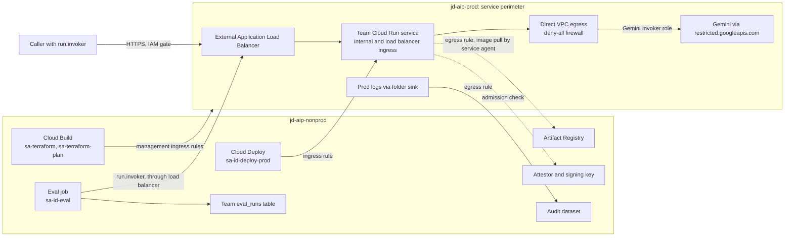
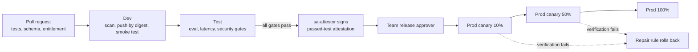

# TenantLoom AI Architecture

| Field | Value |
|---|---|
| Owner | Joseph Olutimehin |
| Status | Planned. Nothing in this document is implemented or verified. |
| Build plan | TenantLoom AI |
| Organization | `josephdara.com` (Cloud Identity Free) |
| Footprint | Three projects in `us-east4` |

This document describes the target architecture for TenantLoom AI. Every section describes intended behavior. A control counts as demonstrated only when evidence records the observed result (see [Verification criteria](#16-verification-criteria)). Platform behavior the design depends on but has not yet observed is listed under [Lab checks](#15-lab-checks).

**Values to replace.** The domain, `jd-aip-` project IDs, folder name, group and alert addresses, region, and the prod load balancer's DNS name are the owner's planned values. Anyone reproducing the architecture must substitute their own.

**Naming.** Google renamed Vertex AI to Gemini Enterprise Agent Platform. The API endpoint (`aiplatform.googleapis.com`), IAM role IDs, and the `vertexai.allowedModels` constraint keep the older names, so this document uses both: "Agent Platform" for the product and the original identifiers where APIs, roles, and policies require them.

## 1. Purpose and scope

TenantLoom AI is a small internal AI platform that provisions governed Gemini and Model Garden access to teams in an organization. A platform team owns the guardrails. Teams onboard through a pull request, and a Terraform tenant module turns that request into a ready-to-use slice of the platform: groups, service accounts, a delivery pipeline, a dataset bucket, a budget, and a dashboard.

Two pilot teams exercise the design:

| Team | Workload | Purpose |
|---|---|---|
| `docs` | `extract-api` on Cloud Run | Extract structured fields from documents using Gemini |
| `support` | Ticket summarization service from the starter template | Prove that provisioning is repeatable and that teams stay isolated |

All data in the platform is synthetic.

### Design goals

| Area | Goal |
|---|---|
| Environments | Sandbox, dev, test, and prod across three projects, with controls that tighten toward production |
| Governance | A model catalog enforced by organization policy, defined data lifecycles, audit logging, and per-team showback |
| Access | A full identity matrix, isolated team slices in nonprod and prod, keyless service accounts, and time-bound prod access through Privileged Access Manager (PAM) |
| Workflows | Pull request onboarding and offboarding, and a standard promotion pipeline with gates, attestation, canary, and rollback |
| MLOps | Reproducible evaluation records, version pinning, experiment tracking, and quality monitoring in prod |
| Security | Enforced invoker IAM, a prod service perimeter with documented flows, Model Armor, CMEK, and Binary Authorization |
| Documentation | A service catalog, onboarding guide, access requirements, RACI, runbooks, and ADRs in Confluence |

## 2. Resource hierarchy

```text
josephdara.com (organization, Cloud Identity Free)
└── ai-platform (folder)
    ├── jd-aip-sandbox    shared exploration, Model Garden trials, model evaluation
    ├── jd-aip-nonprod    dev and test, Terraform state, Cloud Build, Cloud Deploy,
    │                     Artifact Registry, golden datasets, audit and eval data
    └── jd-aip-prod       production workloads, load balancer, CMEK keys, service perimeter
```

Dev and test share `jd-aip-nonprod` and are separated by service accounts, Cloud Run services, buckets, and IAM. Delivery tooling also lives in nonprod, which keeps prod free of build infrastructure. Sandbox is shared by all teams on purpose and holds synthetic data only, so team isolation applies to nonprod and prod.

## 3. Environments

Each environment's controls tighten toward production:

| Environment | Project | Purpose | Model access | Key controls |
|---|---|---|---|---|
| Sandbox | `jd-aip-sandbox` | Shared exploration and candidate evaluation | Catalog models plus candidates; deploy allowed for one open model | Shared by all teams, synthetic data only, endpoint expiry cleanup, Model Armor inspect only |
| Dev | `jd-aip-nonprod` | Integration, deployed on merge | Approved models, predict only | Pipeline-only changes, Model Armor inspect and block |
| Test | `jd-aip-nonprod` | Eval, latency, and security gates | Approved models, predict only | Gates must pass before a release is attested |
| Prod | `jd-aip-prod` | Serves team workloads | Approved models, predict only | Attested images only, approval and canary, perimeter, ingress only from inside and through the load balancer, all egress through a VPC, CMEK, no standing human access |

## 4. Data flows and the prod perimeter

Every flow below is specified before the prod perimeter is enforced:

| Flow | Identity and permission | Network and perimeter |
|---|---|---|
| Caller to Cloud Run | Caller holds `roles/run.invoker` on that team's service; `run.managed.requireInvokerIam` keeps the IAM check on | Through the external Application Load Balancer in prod; services accept only internal and load balancer traffic (`run.allowedIngress`); unauthenticated calls return 403 |
| Cloud Run to Gemini | The team's runtime service account with the custom Gemini Invoker role | Direct VPC egress with all traffic routed through the VPC (`run.allowedVPCEgress`) on a subnet with Private Google Access; DNS sends Google API names to `restricted.googleapis.com`; `us-east4` regional endpoint inside the perimeter |
| Prod workload egress | Any prod Cloud Run service | A deny-all egress firewall rule allows only the restricted Google API range, and the perimeter's VPC accessible services are limited to its restricted services, so the internet and every Google API outside that list are unreachable |
| Eval and canary jobs to prod | `sa-<id>-eval`, running as a Cloud Run job in nonprod, with `run.invoker` on the team's prod service only | Through the prod load balancer like any other caller; dataset reads and writes to the team's `eval_runs` table stay in nonprod |
| Prod to shared data | Folder log sink writer identity | Egress rule to the audit dataset in nonprod only |
| Delivery to prod | Cloud Deploy runs prod rollouts as the target's execution account, `sa-<id>-deploy-prod`, with Cloud Run Developer and `actAs` on the team's prod runtime account | Ingress rule for the `deploy-prod` accounts; egress rule for prod's Cloud Run service agent to pull images from Artifact Registry in nonprod |
| Prod admission | Binary Authorization in prod checks each image for the passed-test attestation from the attestor in nonprod | Binary Authorization and Container Analysis are not restricted services, so no rule is needed |
| Terraform management | `sa-terraform` applies and `sa-terraform-plan` reads prod resources from Cloud Build in nonprod; the break-glass account recovers | Ingress rules: `sa-terraform` for all restricted services, `sa-terraform-plan` for read methods where a service supports method limits, and the break-glass account for recovery |
| Prod access through PAM | Members of `<id>-developers` with an active `<id>-prod-read` grant, and platform admins with an active `platform-prod-admin` grant | Ingress rules for those groups, generated from `tenants/`: read methods on Cloud Run and Cloud Logging for each team's developers, and the restricted services for platform admins; IAM still refuses access without an active grant |

The prod perimeter restricts Agent Platform, Cloud Run, Cloud Storage, BigQuery, Cloud KMS, Artifact Registry, and Cloud Logging, and its VPC accessible services are set to those restricted services. It stays in dry-run mode until every flow above runs with zero violations. Zero violations shows that permitted paths work, not that prohibited ones fail, so enforcement is accepted only after tests show that internet egress from a prod container, a call to a supported Google API outside the restricted list, a write to storage outside the perimeter, and an unauthenticated call all fail. ADR-005 records why eval jobs and the attestor stay in nonprod, and ADR-007 records the prod network path.



## 5. Platform foundation

- **Bootstrap.** Break-glass applies the platform Terraform root once from the admin workstation, limited to the bootstrap resources and using local state: the three projects under the existing `ai-platform` folder, the state bucket, `sa-terraform` and `sa-terraform-plan` with their roles, a temporary probe account, the GitHub connection, and the platform Cloud Build triggers. The state then moves into the new bucket, and from then on humans no longer apply Terraform (ADR-004). Four steps happen outside Terraform: assigning Groups Admin to `sa-terraform` and a read-only groups role to `sa-terraform-plan` in the Admin console, authorizing the GitHub connection in the console, and setting the branch ruleset on `main` in GitHub.
- **Probe.** `sa-probe-build` holds exactly the roles a team build account will get. Showing that it cannot read or write the state bucket is the foundation's exit test, and it is deleted afterward.
- **State.** One bucket in `jd-aip-nonprod` with uniform access and the GCS backend's built-in locking. Prefixes are `platform/` and `tenants/<id>/`. Only `sa-terraform` can write it, `sa-terraform-plan` can read it, and break-glass recovers it. Platform state manages the bucket itself, protected by `prevent_destroy`, object versioning with a retention period for noncurrent versions, and soft delete, so earlier versions recover a damaged state (ADR-004).
- **Ownership.** Platform state owns organization policies, the folder, projects, perimeter, catalog allowlists, and shared tooling. Each tenant state owns only that team's slice. No resource appears in two states.
- **Plan and apply.** Pull request builds run only for repository collaborators and plan as `sa-terraform-plan`, which has no write access anywhere and plans without taking the state lock. Pull request code runs during a plan, so that identity holds nothing worth stealing beyond read access, and state must never contain secrets. On merge, a build running as `sa-terraform` saves the plan and shows it, and a separate apply build waits for Cloud Build approval from `ai-governance`, then applies exactly that saved plan as `sa-terraform`. Terraform rejects a saved plan if the state changed after it was made. Every platform and tenant apply waits for approval, because almost every change touches prod, IAM, or policy (ADR-004). CODEOWNERS assigns the whole repository to `ai-governance`, including `cloudbuild/` and the CODEOWNERS file, because the merge-time build runs repository code as `sa-terraform` before the apply approval. A branch ruleset on `main` requires a pull request and code owner approval, with no bypass.
- **Tenant builds.** Each team's trigger fires only on its own repository and runs as `sa-<id>-build`, which cannot read the state bucket or impersonate `sa-terraform`. Team identities never get project-level storage roles or `roles/cloudbuild.builds.builder`, which grants read and write on every bucket in its project, including the state bucket.
- **Failed apply.** Fix forward through a pull request. Restore a previous state version only if the state is damaged, and force-unlock only after confirming no apply is running.

## 6. Tenant provisioning

### Tenant request

A team onboards by adding a file to the `tenants/` directory:

```yaml
tenant: docs
owners_group: docs-owners@josephdara.com
data_classification: confidential    # demonstrated with synthetic data
models: [PINNED_GEMINI_FLASH]
budget_monthly_usd: 50               # covers dev, test, and prod
alert_channel: docs-alerts@josephdara.com
```

`tenant` is the team's ID. It is used unchanged in the file name, labels, groups, and service accounts. CI requires 3 to 15 lowercase letters or digits, starting with a letter, so the longest service account ID, `sa-<id>-deploy-prod`, stays within the 30-character limit.

### What the tenant module creates

- Cloud Identity groups `<id>-developers` and `<id>-release-approvers`, managed by the team's owners group.
- Runtime, eval, build, and deploy service accounts with the scopes in the [identity matrix](#identity-and-isolation-matrix).
- A Cloud Deploy pipeline with dev, test, and prod targets, a Cloud Build trigger on the team's repository, and an Artifact Registry repository.
- A golden dataset bucket with separate development and held-out paths.
- IAM on the team's own services, bucket, and repository, plus a log view scoped to the team.
- A budget filtered by the team label, with alerts to the team channel.
- A PAM entitlement for scoped read-only prod access.
- An onboarding summary generated from Terraform outputs.

### Onboarding workflow

1. The team opens a pull request adding `tenants/<id>.yaml`.
2. CI validates the file, checks requested models against the catalog and data classification, and posts the Terraform plan made by `sa-terraform-plan`.
3. A member of `ai-governance` reviews and approves the pull request, as CODEOWNERS requires.
4. Merge saves a new plan as `sa-terraform`, and a member of `ai-governance` approves that saved plan in Cloud Build.
5. The apply build applies it. Readiness checks then deploy the starter service to dev, call it as a team developer, and confirm the team's log view.

Time to provision is measured from approval of the saved plan to passing readiness checks, with a one-hour target.

### Recovery and offboarding

- **Failed provisioning.** The tenant apply is idempotent. Partial resources stay in the team's own state, and a rerun after the fix completes the slice.
- **Offboarding.** Disable the team's trigger and pipeline, remove its IAM bindings, disable its service accounts, export its audit history and eval results to an auditor-readable archive bucket, then destroy only the team's state. Other teams' resources live in other states and are untouched.

## 7. Governance

### Model access boundary

`vertexai.allowedModels` applies to every principal in a project, so teams sharing a project share one allowlist. The first version uses that shared allowlist as the runtime boundary and enforces each team's model choice in CI: a release configuration that names a model outside the team's entitlements fails before build.

Because this is a delivery-time control, a team could still call another allowlisted model at runtime. ADR-001 will record this as an accepted risk, with a platform-owned model gateway as the upgrade path if per-team runtime limits become a requirement.

Model access tests:

- An allowlisted model call succeeds.
- A non-allowlisted call returns permission denied.
- A release naming a non-entitled model fails CI.

### Model catalog

`catalog/catalog.yaml` lists approved models with pinned version, deployment pattern, permitted data classifications, eval report, approver, and retirement date. Terraform generates a `vertexai.allowedModels` policy for each project from it: broader in sandbox, approved predict-only models in nonprod and prod. Example for prod:

```yaml
name: projects/jd-aip-prod/policies/vertexai.allowedModels
spec:
  rules:
  - values:
      allowedValues:
      - publishers/google/models/PINNED_GEMINI_FLASH:predict
```

New models enter the catalog after an evaluation in sandbox, a pull request with the eval report, and `ai-governance` approval. Sixty days before a pinned model's retirement date, the platform team evaluates the replacement and adds it to the catalog. Teams switch through their pipelines, and the old model leaves the allowlist once no team uses it or at retirement.

### Organization policy baseline

| Constraint | Effect |
|---|---|
| `iam.disableServiceAccountKeyCreation` | No long-lived keys |
| `iam.allowedPolicyMemberDomains` | Only `josephdara.com` identities receive access, which also blocks `allUsers` |
| `run.managed.requireInvokerIam` | Every Cloud Run service keeps the IAM invoker check |
| `iam.automaticIamGrantsForDefaultServiceAccounts` | Default service accounts do not receive Editor |
| `gcp.resourceLocations` | Resources stay in US locations |
| `storage.uniformBucketLevelAccess`, `storage.publicAccessPrevention` | IAM-only, never-public buckets |
| `vertexai.allowedModels` | Per-project model allowlist generated from the catalog |
| `run.allowedBinaryAuthorizationPolicies` on `jd-aip-prod` | Every prod Cloud Run service must use the project's Binary Authorization policy, so a deployer cannot turn enforcement off |
| `run.allowedIngress` on `jd-aip-prod` | Prod services accept only internal and load balancer traffic |
| `run.allowedVPCEgress` on `jd-aip-prod` | Prod services send all outbound traffic through the VPC |
| Custom breakglass constraint on `jd-aip-prod` | Rejects any service create or update that requests Binary Authorization breakglass |

### Data lifecycle

Each data type has a defined location, reader set, retention period, and key:

| Data | Location | Readers | Retention | Encryption |
|---|---|---|---|---|
| Golden datasets | Team bucket in nonprod | Team developers (development path), team eval account (both paths) | Versioned; archived at offboarding | Google-managed |
| Evaluation results | One `eval_runs` table per team in a shared nonprod dataset | The team's groups (own table), `ai-governance` (all tables through a union view) | 1 year | Google-managed |
| Application logs | Log bucket per project, team log views | Team developers (own view), platform admins | 30 days nonprod, 90 days prod | CMEK in prod |
| Audit logs | BigQuery audit dataset in nonprod | Auditors | 1 year | Google-managed |
| Model Armor logs | Restricted log bucket in nonprod and prod | Auditors | 30 days | CMEK in prod |

Bucket lifecycle rules, table expiration, and log bucket retention enforce these periods. Prod CMEK keys sit in one key ring in `jd-aip-prod`, and only the Storage, BigQuery, and Logging service agents for that project can use them. Keys stay active after a team offboards until its retained data expires.

Each team's eval account can write only its own `eval_runs` table. Row-level policies are not used for isolation, because they filter reads and do not restrict writes. Platform state owns the governance union view and generates it from the active teams in `tenants/`; each tenant state owns only its own table and grants.

### Audit log coverage

Admin Activity audit logs are always on. Data Access audit logs are enabled on the `ai-platform` folder for Agent Platform, IAM (including service account credential use), Cloud Storage, Secret Manager, and Cloud KMS. BigQuery Data Access logs are on by default. A folder log sink sends audit logs from all three projects to the audit dataset. Before this coverage is relied on, representative events are confirmed in the dataset: a model call, a held-out dataset read, a service account token request, a KMS key use, and a secret access.

### Cost attribution

- **Labels.** Every resource the tenant module creates carries `tenant` and `env` labels, and the starter template sends the tenant label on every Gemini request.
- **Budgets.** A team's budget covers its dev, test, and prod usage. Sandbox and shared tooling count as platform cost, split evenly across active teams. Unlabeled usage is reported as platform cost and investigated in the monthly review.
- **Showback.** A monthly report per team from the billing export joined with labels. Token counts from logs are compared with billed Gemini usage, and a gap over 10% is investigated.
- **Cost safeguards.** Budgets only send alerts, and nothing stops spend automatically. Cloud Run maximum instances and concurrency limit serving capacity per environment, but they do not bound cumulative Gemini tokens, retries, or evaluation spend, and Cloud Run can briefly exceed its instance limit. Agent Platform quota limits set per project cap request and token rates. Team owners act on team budget alerts, and the platform team acts on project budget alerts. An automatic stop on budget alerts is possible future work.

## 8. Access control

### Identity and isolation matrix

| Identity | Scope | Can | Cannot |
|---|---|---|---|
| `<id>-developers` | Sandbox project; the team's dev and test services, bucket, and log view | Experiment in sandbox, invoke and view own nonprod services, read own logs and development data | Access another team's resources, deploy, or act as any service account |
| `<id>-release-approvers` | The team's prod target and services | Approve the team's prod releases and view its services | Change pipelines, verification jobs, or thresholds |
| `sa-<id>-run-<env>` | One environment's project | Call allowlisted Gemini models and write logs and metrics | Read other teams' data or deploy |
| `sa-<id>-eval` | The team's test and prod services, dataset, and its own `eval_runs` table | Invoke the team's services, read its dataset, write results to its own table | Write another team's table, change thresholds, or deploy |
| `sa-<id>-build` | The team's repository, Artifact Registry repository, and pipeline; no project-level storage roles | Build, push, and create releases for that team | Read Terraform state, impersonate `sa-terraform`, or touch other teams' pipelines |
| `sa-<id>-deploy-<env>` | The team's Cloud Run services in one environment; execution account for that Cloud Deploy target | Deploy revisions, act as that team's runtime account, and start the team's eval job for verification | Deploy other teams' services |
| `sa-attestor` | The attestor and its KMS signing key in nonprod | Sign the passed-test attestation after test gates pass | Be used by tenant triggers |
| `sa-terraform` | Admin roles for each managed service on the `ai-platform` folder, inherited by the three projects; organization policy and Access Context Manager administration at the organization; Billing Account Costs Manager and Billing Account User; Groups Admin in Cloud Identity; Role Administrator on each project; `actAs` on itself so it can manage its own triggers (full list in ADR-004) | Apply platform and tenant infrastructure, including model allowlists, the perimeter, budgets, and team groups | Be used by pull request builds or by anything other than the merge-time platform triggers |
| `sa-terraform-plan` | A custom read-only role in each project without job creation or log-entry reads; Security Reviewer on the folder; read-only roles on organization policies, the access policy, the billing account, and groups; object read on the state bucket (full list in ADR-004) | Plan pull requests | Write anything, create jobs, take the state lock, read secrets, or act as another service account |
| `auditors` | Audit dataset and Model Armor log buckets | Read audit and prompt logs | Write or change anything |

Groups Admin lets `sa-terraform` change any group, including `ai-governance` and `auditors`. A Terraform change to either group needs CODEOWNERS review and apply approval, and a membership change made any other way raises an alert (ADR-004).

Project IAM Admin lets `sa-terraform` grant itself any role in the three projects, so its role list records intent rather than a hard limit. The controls are approval on every apply, CODEOWNERS, and the monthly access review, which flags any grant to `sa-terraform` that ADR-004 does not list.

### Temporary production access

| Entitlement | Grants | Duration | Approval |
|---|---|---|---|
| `<id>-prod-read` | `roles/run.viewer` and log view access on the team's prod services, scoped with IAM conditions | Up to 2 hours | A team release approver |
| `platform-prod-admin` | `roles/run.admin` and `roles/aiplatform.admin` on `jd-aip-prod` | Up to 1 hour | `ai-governance`, with a justification; every use is reviewed afterward because it sees every team's prod resources |

PAM grants IAM roles only. Perimeter ingress rules for the eligible groups provide the network path, and IAM refuses access whenever no grant is active (ADR-007).

A monthly query over a Cloud Asset Inventory export flags user-level bindings, Owner or Editor grants, and any cross-team binding.

## 9. Security

- **Authentication.** Invoker IAM is enforced by organization policy on every Cloud Run service, and unauthenticated calls are part of the security gate. Prod callers reach services only through the load balancer.
- **Perimeter.** VPC Service Controls around `jd-aip-prod`, with restricted ingress, all egress through the VPC, and the restricted services and rules listed under [Data flows](#4-data-flows-and-the-prod-perimeter) (ADR-007).
- **Model Armor.** Floor settings per project cover prompt injection, jailbreaks, sensitive data, and malicious URLs. Sandbox inspects only; nonprod and prod inspect and block.
- **Supply chain.** Artifact Analysis scans images, and deployments use digests. Binary Authorization in prod admits only digests carrying the passed-test attestation, which `sa-attestor` signs with a KMS key after the test gates pass. The attestor, its note, and the signing key live in `jd-aip-nonprod` next to the test gates. `run.allowedBinaryAuthorizationPolicies` stops a deployer from turning enforcement off, and a custom organization policy constraint on `jd-aip-prod` rejects any service update that requests breakglass, so emergency breakglass requires the break-glass administrator to lift that constraint, a change that is itself logged and alerted. Release CI also rejects rendered manifests that carry the breakglass annotation, and every breakglass event raises an alert (ADR-005).
- **Threat model.** Covers cross-team access, unapproved models, unauthenticated calls, prompt injection, data exfiltration from prod, unreviewed prod changes, and cost abuse, each mapped to the controls above.

## 10. Delivery workflow

### Promotion path

1. **Sandbox to dev.** A pull request carries the change and, for model or prompt changes, a sandbox eval report. CI runs tests, schema checks, the entitlement check, and a check that rendered manifests carry no Binary Authorization breakglass annotation.
2. **Dev.** Merge triggers the team's build to scan, push by digest, and create a Cloud Deploy release that rolls out to dev with a smoke test.
3. **Test.** Cloud Deploy promotes the release automatically. Its verification step starts the team's eval job in nonprod, which runs the eval, latency, and security gates, and `sa-attestor` signs the passed-test attestation only when all three pass.
4. **Prod.** A team release approver approves. The release rolls out as a canary at 10%, 50%, then 100%, with verification at each step.



Each release record ties together the image digest, model ID, prompt version, generation parameters, eval run ID, and attestation, stored in the Cloud Deploy release annotations and the team's `eval_runs` table.

### Gates

Every tenant runs the same gates:

| Gate | Stage | Pass criteria |
|---|---|---|
| CI checks | Pull request | Tests, schema, and entitlement check pass; no breakglass annotation in rendered manifests |
| Eval gate | Test | `docs`: field exact-match accuracy at least 90% and no more than 2 percentage points below prod. `support`: mean rubric score at least 4.0 of 5 and no more than 0.2 below prod. 100% schema validity. The first release uses absolute thresholds only. |
| Latency gate | Test | p95 end-to-end latency at or below 4 seconds across the eval run |
| Security gate | Test | Unauthenticated and cross-team calls denied, known prompt-injection set blocked, non-allowlisted model denied, no user-level or cross-team bindings |
| Approval | Prod | Approved by a team release approver |
| Canary | Prod | At 10% and 50%: at least 50 requests sent directly to the candidate revision, plus a mixed-traffic check through the service; on the candidate, error rate under 1%, 100% schema validity, and p95 within target. Held-out items are sampled with replacement and logged by item ID. |

Minimum thresholds and the verification job image are platform-owned in `verification/` and change only through reviewed pull requests. Teams can set stricter thresholds in their own repository.

### Rollback

A Cloud Deploy repair rule rolls back automatically when canary verification fails, returning traffic to the last successful release. After a full rollout, the runbook runs a Cloud Deploy rollback to the previous release. Image, model configuration, and prompt version ship in one release, so a rollback restores all three together. Each team drills both cases.

## 11. MLOps and evaluation

### Evaluation record

Every eval run writes a record a reviewer can trace a release decision back to:

- Dataset version and content hash
- Model ID, prompt version, and generation parameters
- Application image digest and harness version
- Metric definitions, thresholds, and results
- Judge model and rubric version for model-based scoring

### Datasets and harness

- **`docs`:** 80 labeled documents, 50 for development and 30 held out.
- **`support`:** 40 tickets with reference summaries, 25 for development and 15 held out, scored by a judge model on a 5-point rubric.
- **Held-out protection:** held-out paths are readable only by the team's eval account, so prompt work only ever sees the development set.
- **Harness:** a container using the Gen AI evaluation service, logging to Agent Platform Experiments and the team's `eval_runs` table.
- **Catalog evaluation:** Gemini Flash and Gemini Pro (pinned versions) against Gemma from Model Garden, deployed in sandbox only for the eval window or used through Model as a Service (MaaS). Publisher, MaaS, and self-deployed patterns are compared in an ADR.

### Monitoring and objectives

| Objective | Target |
|---|---|
| Availability | 99.5% of requests to each prod service succeed (non-5xx) over a rolling 28 days |
| Latency | 95% of prod requests complete within 4 seconds over a rolling 28 days |
| Quality | A daily canary eval job in nonprod sends 20 held-out items to each prod service and alerts if the score falls below the gate threshold |
| Dashboards | One per team for requests, errors, latency, tokens, Model Armor blocks, and cost |

## 12. Operations

### Responsibilities

| Activity | Platform team | Governance | Team |
|---|---|---|---|
| Team onboarding and offboarding | Responsible | Accountable | Consulted |
| Catalog additions and retirements | Responsible | Accountable | Consulted |
| Policy and module changes | Responsible, Accountable | Consulted | Informed |
| Prod releases | Consulted | Informed | Responsible, Accountable |
| Workload incidents | Consulted | Informed | Responsible, Accountable |
| Access reviews and drift review | Responsible | Accountable | Consulted |

### Routines

- **Drift.** A weekly scheduled plan runs across platform and tenant states, and any difference opens an issue for the platform team.
- **Module changes.** Changes to the tenant module apply to `support` first and roll to `docs` after its readiness checks pass.
- **Reviews.** Monthly access review, showback reconciliation, and catalog retirement check.

### Documentation

- **Confluence space:** service catalog, team onboarding guide, access requirements, deployment workflow guide, and the RACI, with key pages exported to PDF in the repository.
- **Runbooks:** prod rollback, failed provisioning, failed apply, offboarding, model retirement, Model Armor block spike, 429 responses from Agent Platform, Binary Authorization breakglass event, and break-glass access.
- **Diagrams:** project layout and data flows, onboarding flow, promotion pipeline with gates, and identity matrix.

## 13. Planned repository layout

```text
tenantloom-ai/
├── terraform/                 platform root: bootstrap set, org policies, projects, perimeter, platform IAM
│   └── modules/tenant/        team slice
├── tenants/                   docs.yaml, support.yaml
├── catalog/                   catalog.yaml, eval reports
├── verification/              platform-owned gate jobs and minimum thresholds
├── templates/starter-service/
├── eval/                      harness and evaluation record schema
├── cloudbuild/                platform plan and apply, tenant build template
└── docs/                      guides, runbooks, ADRs, diagrams, evidence
```

## 14. Planned architecture decision records

ADRs live in `docs/adr/`. ADR-004, ADR-005, and ADR-007 are written; the others are planned.

| ADR | Decision |
|---|---|
| ADR-001 | Model access boundary: shared project allowlist at runtime, per-team entitlement enforced in CI |
| ADR-002 | Three-project layout |
| ADR-003 | Team isolation in shared projects, including team IDs |
| [ADR-004](docs/adr/ADR-004-state-and-ci-ownership.md) | State and CI ownership: `sa-terraform` scope, read-only pull request plans, approval on every apply, protected state bucket |
| [ADR-005](docs/adr/ADR-005-attested-promotion.md) | Attested promotion with Cloud Deploy: attestor and eval jobs in nonprod, enforced Binary Authorization, per-team eval tables, candidate-targeted canary |
| ADR-006 | Deployment patterns: publisher, MaaS, and self-deployed |
| [ADR-007](docs/adr/ADR-007-prod-network-path.md) | Prod network path under VPC Service Controls: load balancer ingress, VPC egress, restricted Google APIs |

## 15. Lab checks

The design depends on the platform behavior below, which is documented or expected but not yet observed. Each check must pass in the lab, with evidence, before the related control is relied on. Where a check names a fallback, that is the alternative if it fails.

1. **Organization policy at project level.** With Organization Policy Administrator granted at the organization, `sa-terraform` can set `vertexai.allowedModels` and other policies on the three projects (ADR-004).
2. **Group membership alert.** Cloud Identity Free can share its audit logs with Cloud Logging, so a membership change to `ai-governance` or `auditors` raises an alert. Fallback: a scheduled job compares both groups with their expected members (ADR-004).
3. **Prod admission under enforcement.** With the prod perimeter enforced, deploys checked against the attestor in nonprod and image pulls by prod's Cloud Run service agent succeed. Fallback: move the attestor and attestations into `jd-aip-prod` with an ingress rule for `sa-attestor` (ADR-005).
4. **Calls through the load balancer.** With the perimeter enforced, an authorized caller and the nonprod eval job reach a prod service through the external Application Load Balancer, with IAM still checked. Whether this path needs a perimeter ingress rule is not yet known. Fallback: an ingress rule for the load balancer path (ADR-007).
5. **Blocked paths fail.** From a prod container, an internet request fails; a call to a Google API that VPC Service Controls supports but the perimeter does not restrict fails with a VPC Service Controls denial, even with credentials that would otherwise allow it; a write to a bucket in another project fails; and an unauthenticated call returns 403 (ADR-007).
6. **Canary reaches the candidate.** Cloud Deploy canary verification can send requests to the candidate revision specifically, for example through a revision tag. Fallback: the verification job reads the candidate revision from the rollout and targets it through a tag route on the load balancer (ADR-005).
7. **Audit events arrive.** The representative events listed under [Audit log coverage](#audit-log-coverage) reach the audit dataset.
8. **Binary Authorization cannot be turned off or bypassed.** In `jd-aip-prod`, a deploy without Binary Authorization is refused, and the custom constraint refuses breakglass requested through either the manifest annotation or the API's breakglass field. Fallback: accept deployer breakglass as a detected risk, alerted on every use (ADR-005).
9. **CI role lists are complete.** The first apply as `sa-terraform` and the first pull request plan as `sa-terraform-plan` succeed with the roles in ADR-004. Any missing or unused role is corrected in ADR-004.
10. **Conditional invoker grants.** A project-level `run.invoker` grant conditioned on service names that start with `<id>-` lets each team's callers invoke only that team's services. Fallback: the tenant module grants invoker on each service after its first deploy (ADR-004).
11. **Groups reader.** A read-only groups admin role assigned to `sa-terraform-plan` lets it read team groups and memberships through the Cloud Identity API. Fallback: pull request plans that touch groups fail, and those changes are planned at merge time instead (ADR-004).
12. **Probe denied.** `sa-probe-build`, holding only the roles a team build account will get, cannot read or write the state bucket. If it can, a project-level role is leaking storage access and is removed before any team onboards (ADR-004).
13. **Terraform management under enforcement.** With the perimeter enforced, plans as `sa-terraform-plan` and applies as `sa-terraform` succeed against prod resources through the management ingress rules, and break-glass recovery access works (ADR-004, ADR-007).
14. **Workload APIs on the restricted list.** Every Google API the starter service calls is on the perimeter's restricted list, so the VPC accessible services setting does not block it (ADR-007).
15. **Review covers the whole repository.** A pull request that changes only `cloudbuild/` or the CODEOWNERS file cannot merge without `ai-governance` approval (ADR-004).
16. **PAM access through the perimeter.** With the perimeter enforced, a team developer with an active `<id>-prod-read` grant can view the team's prod services and logs and is refused after the grant expires, and the same holds for `platform-prod-admin` (ADR-007).

## 16. Verification criteria

A control counts as demonstrated only when evidence records the observed result. The design is complete when:

- Both teams run in prod, each having released and rolled back through its own pipeline.
- Isolation tests show a developer from one team is denied the other team's data, logs, service accounts, and deployments.
- Model access tests match ADR-001.
- Unauthenticated and unauthorized Cloud Run calls fail, and every documented flow works under perimeter enforcement.
- Exfiltration tests show that internet egress and writes outside the perimeter fail from prod.
- A prod deploy with Binary Authorization turned off, or with breakglass requested, is refused.
- A tenant build is denied access to Terraform state.
- Onboarding time is measured from approval to passing readiness checks.
- An eval report is reproducible and matches its release record.
- A release stops at test, and a failed canary rolls back automatically.
- A monthly showback report reconciles with billing.
- An offboarding drill removes `support` while `docs` keeps serving, then onboards `support` again.
- The Confluence page tree and exported PDFs are in place.
