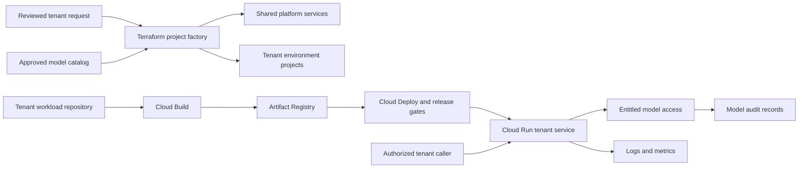
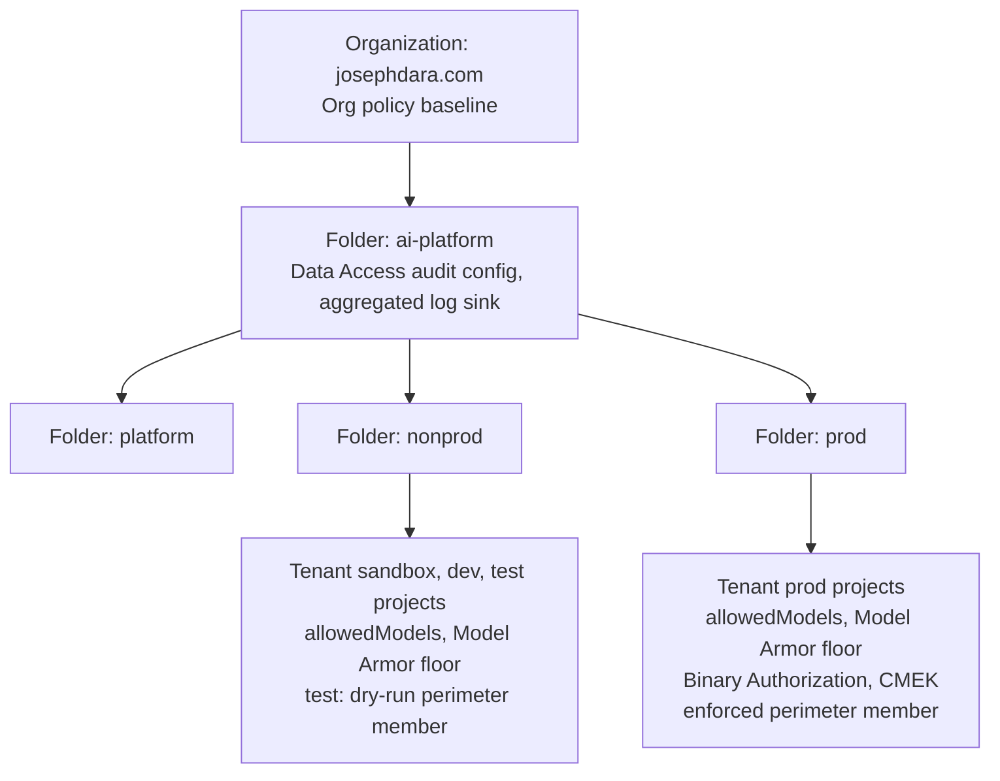
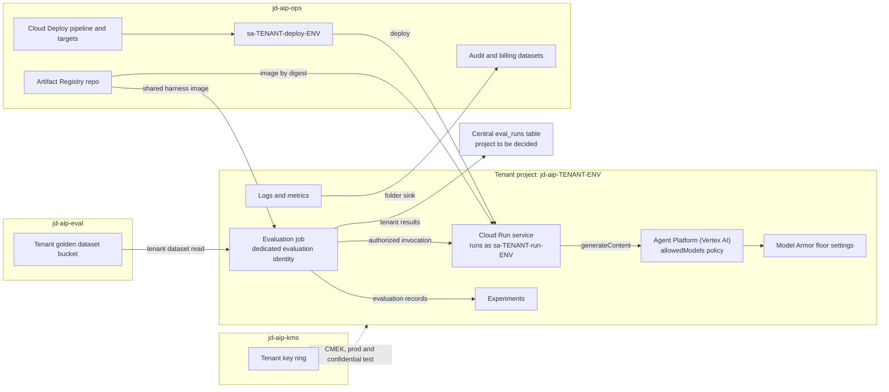
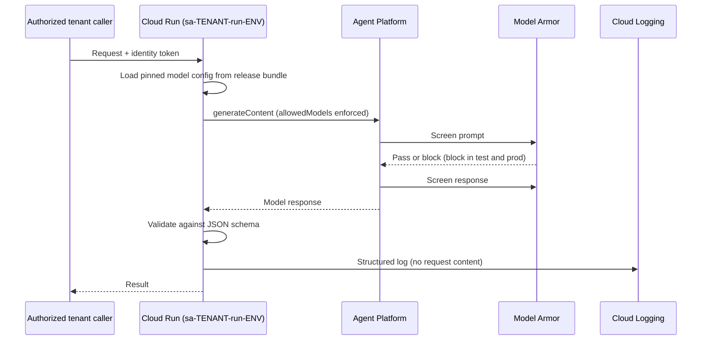
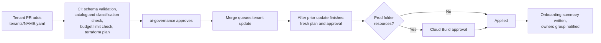
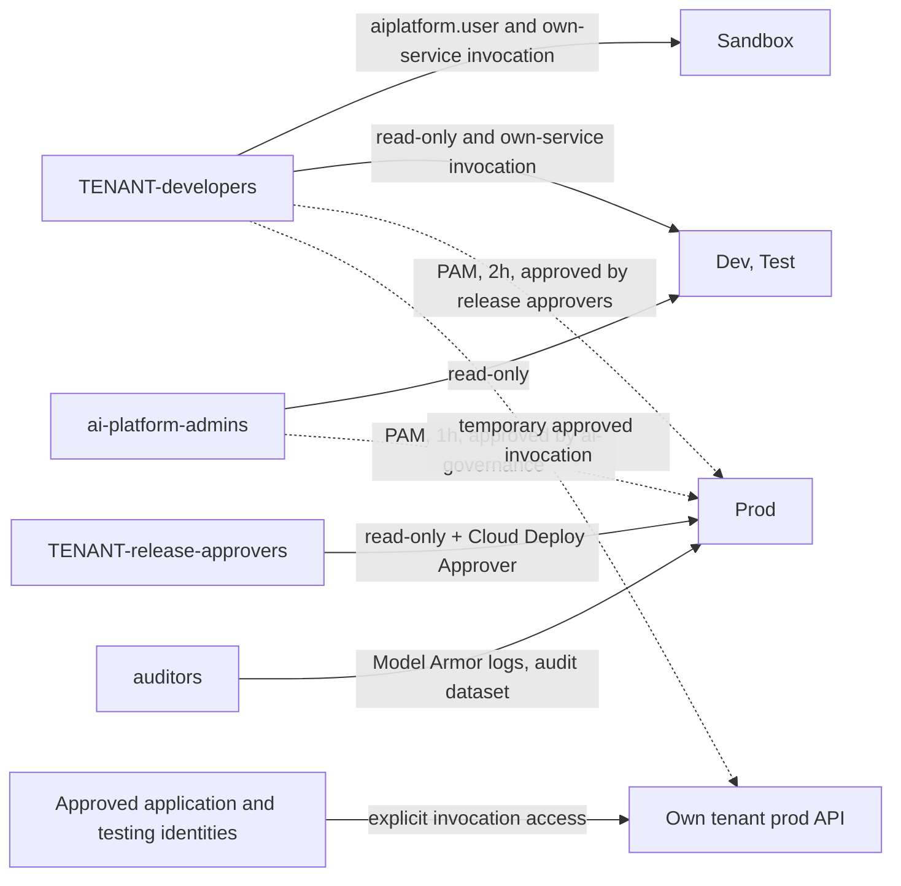
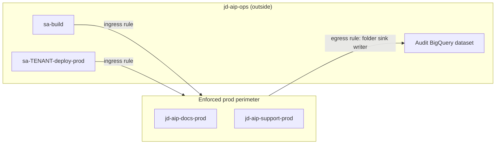
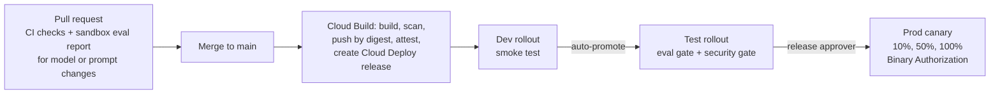

# TenantLoom AI Architecture

| Field | Value |
|---|---|
| Owner | Joseph Olutimehin |
| Status | Planned. Nothing in this document is implemented or verified. |
| Build plan | TenantLoom AI |
| Organization | `josephdara.com` (Cloud Identity Free) |
| Primary region | `us-east4` |

This document describes the target architecture for TenantLoom AI. Everything below captures intended behavior. A capability counts as demonstrated only when supporting evidence records the observed result (see [Verification and evidence boundaries](#18-verification-and-evidence-boundaries)). Unresolved technical details are listed under [Decisions requiring resolution](#17-decisions-requiring-resolution).

**Values to replace.** The domain, organization and billing identifiers, `jd-aip-` project IDs, group addresses, notification addresses, and region are the owner's planned values. Anyone reproducing the architecture must substitute their own.

**Naming.** This document uses "Agent Platform (Vertex AI)" for the model platform and retains identifiers such as `aiplatform.googleapis.com`, `roles/aiplatform.*`, and `vertexai.allowedModels` for APIs, roles, and policies. Product naming, model availability, and exact service support require confirmation during implementation.

## 1. Purpose and scope

TenantLoom AI is an internal GCP platform that provisions governed access to Gemini and Model Garden models for application teams. A platform team owns shared infrastructure, guardrails, delivery templates, and the model catalog. Each application team is a tenant that requests environments, model access, and budgets through pull requests. An approved request drives a Terraform project factory that creates the tenant's projects, identities, entitlements, security controls, delivery pipeline, budgets, and observability from a common definition. The target is repeatable onboarding with no manual tenant setup beyond approvals, once the platform foundation exists.

Two planned pilot tenants exercise the architecture:

| Tenant | Workload | Purpose |
|---|---|---|
| `team-docs` | `extract-api` on Cloud Run | Extract structured fields from document text using Gemini |
| `team-support` | Ticket summarization service on Cloud Run | Summarize tickets using the shared starter template |

### Design goals

| Area | Goal |
|---|---|
| Provisioning | An approved tenant request becomes fully configured environments with no manual steps |
| Environments | Sandbox, dev, test, and prod for every tenant, from the same modules, with controls that tighten toward prod |
| Governance | Org-wide model catalog, per-tenant entitlements enforced by org policy, data classification and retention, central audit logging, per-tenant showback |
| Access | Group-based IAM, tenant isolation, least-privilege service accounts, no standing human prod access, time-bound elevation through Privileged Access Manager (PAM) |
| Workflows | Request workflows for onboarding, model access, and budgets; one promotion pipeline every tenant inherits |
| MLOps | Shared evaluation service, version pinning, experiment tracking, prod quality monitoring, model upgrade process |
| Security | VPC Service Controls, Model Armor, CMEK, Binary Authorization, keyless authentication, written threat model |

## 2. Operating model and ownership

The architecture separates platform provisioning, tenant delivery, and runtime inference.

| Role | Group | Responsibility |
|---|---|---|
| Platform team | `ai-platform-admins` | Org hierarchy, bootstrap, shared projects, Terraform modules, policies, perimeters, logging, billing export, catalog, templates, mandatory release checks, and minimum quality thresholds. Works through Terraform only. |
| Governance reviewers | `ai-governance` | Onboarding approval, catalog additions, model entitlements, budget increases above the platform limit, offboarding approval |
| Tenant teams | `<tenant>-developers`, `<tenant>-release-approvers` | Application code, prompts, datasets, runtime configuration, eval thresholds, prod releases, workload incidents |
| Auditors | `auditors` | Audit data, restricted Model Armor logs, and access review findings across tenants |

- **Platform-owned:** platform projects, org policies, model catalog, perimeters, log sinks, billing export, Terraform modules, templates.
- **Tenant-owned:** workload code, prompts, golden datasets, thresholds at least as strict as platform minimums, runtime configuration, and prod release approval.

Platform resources change only through reviewed Terraform. Tenant workloads deploy through the standard pipeline. Sandbox permits console, notebook, and CLI experimentation within its guardrails; other environments change only through delivery and provisioning workflows.



This is a logical view. Shared services and cross-project access still require explicit IAM and service perimeter design.

### Platform services (what every tenant receives)

| Service | Contents |
|---|---|
| Tenant environments | Sandbox, dev, test, prod projects with baseline policies, labels, logging, budgets |
| Model access | Catalog models entitled to the tenant, scoped per environment |
| Delivery pipeline | Cloud Deploy pipeline, Cloud Build triggers, Artifact Registry repository |
| Evaluation service | Centrally maintained harness, tenant-local evaluation jobs and identities, Gen AI evals, Experiments, central eval reporting |
| Security baseline | Model Armor, prod perimeter membership, CMEK, Binary Authorization |
| Observability | Dashboards, SLO templates, alerts routed to the tenant channel |
| Showback | Monthly cost by tenant, environment, and model |
| Starter template | Cloud Run plus Gemini service wired to the pipeline, gates, and logging standards |

## 3. Resource hierarchy

Environment folders group projects by control requirements. Tenants are identified by projects, labels, groups, and service accounts, not by tenant folders (ADR-001).

```text
josephdara.com (organization, Cloud Identity Free)
└── ai-platform (folder)
    ├── platform (folder)
    │   ├── jd-aip-bootstrap
    │   ├── jd-aip-ops
    │   ├── jd-aip-eval
    │   └── jd-aip-kms
    ├── nonprod (folder)
    │   ├── jd-aip-docs-sandbox     jd-aip-docs-dev     jd-aip-docs-test
    │   └── jd-aip-support-sandbox  jd-aip-support-dev  jd-aip-support-test
    └── prod (folder)
        ├── jd-aip-docs-prod
        └── jd-aip-support-prod
```

| Shared project | Planned contents |
|---|---|
| `jd-aip-bootstrap` | Terraform state bucket, factory service account |
| `jd-aip-ops` | Cloud Build, Cloud Deploy, per-tenant Artifact Registry repositories, central audit dataset, billing export, monitoring scope |
| `jd-aip-eval` | Catalog evaluation jobs, tenant golden dataset buckets, and temporary self-deployed evaluation endpoints. Tenant workload evaluations execute in their respective tenant environment projects. |
| `jd-aip-kms` | Per-tenant key rings and CMEK keys |

Org and folder policies set the common baseline and are inherited by new projects. Project-level IAM and model policies set tenant-specific access. Perimeter membership is not inherited: the factory explicitly adds prod projects to the enforced perimeter and test projects to the dry-run perimeter.

Each tenant project carries `tenant`, `env`, `cost-center`, and `data-class` labels. Labels support inventory and showback; access boundaries depend on IAM and the security controls below.



## 4. Environment model

| Environment | Purpose | Model access | How changes arrive | Planned controls |
|---|---|---|---|---|
| Sandbox | Exploration, prompt work, candidate evaluation | Sandbox entitlements, including candidates | Console, notebooks, CLI by tenant developers | Synthetic or public data only, endpoint expiry cleanup, Model Armor inspect only |
| Dev | Integration | Dev entitlements, predict only | Tenant pipeline, automatic on merge to main | No console changes, smoke test, Model Armor inspect only |
| Test | Pre-production validation | Test entitlements, predict only | Tenant pipeline, auto-promoted from dev | Eval and security gates, Model Armor inspect and block, perimeter in dry run |
| Prod | Serves the workload | Prod entitlements, predict only | Tenant pipeline with approval and canary | Enforced perimeter, Binary Authorization, CMEK for specified data stores, no standing human access |

Self-deployed model endpoints are limited to sandbox projects and `jd-aip-eval`. They carry an expiry label, and a scheduled Cloud Run job undeploys any endpoint past expiry. The target design sets GPU serving quota to zero in dev, test, and prod through Cloud Quotas, subject to confirming the relevant quota controls.

Cloud Run minimum instances are zero, with instance and concurrency caps per environment. Nonprod scales down through Terraform after evidence capture; prod keeps a minimal demonstration footprint. Environment labels describe intended control levels; availability and operational maturity stay unproven until measured.

## 5. Tenant environment anatomy and runtime flow



### Runtime request flow

1. A caller authorized for this tenant and environment invokes the tenant's Cloud Run service with an identity token. The service must be configured to require IAM authentication. Domain restricted sharing blocks `allUsers` bindings but is not, by itself, verification of the service configuration.
2. The workload loads its pinned model ID, prompt template version, and generation parameters from the release bundle.
3. The environment's runtime service account calls `generateContent` on the entitled model through Agent Platform (Vertex AI).
4. Model Armor screens the prompt and response under the project's floor settings. Sandbox and dev inspect; test and prod inspect and block.
5. The workload validates the response against its JSON schema and returns the result.
6. A structured log records tenant, latency, token counts, model ID, and release ID. Application logs never contain request content.



### API invocation boundary

Invocation permission is separate from deployment, administration, and read-only project access.

| Caller | Sandbox, dev, and test | Prod |
|---|---|---|
| Tenant developers | May invoke their own tenant's services | No standing invocation access; temporary approved access for human testing |
| Approved application identities | Explicit service access where required | Explicit access to the named tenant service |
| Evaluation and smoke-test identities | Access only where the relevant checks run | Explicit access for approved production checks |
| Other tenants | Denied unless explicitly approved | Denied unless explicitly approved |

Every service requires IAM authentication and explicit authorization for its callers. The factory manages the invocation bindings. The mechanism, approver, scope, and expiry for temporary production human testing remain to be specified; the existing read-only investigation entitlement does not by itself define invocation access.

### Workload baseline (starter template)

The starter template enforces IAM authentication, request size limits, separation of instructions from untrusted request content, output schema validation, retries with backoff on 429 responses, the structured logging fields the dashboards expect, and a per-tenant daily token ceiling. Enforcing that ceiling across replicas and environments needs a shared accounting design; its storage and failure behavior remain to be designed.

## 6. Tenant provisioning and lifecycle

### Tenant request

A team onboards by opening a pull request that adds `tenants/<name>.yaml`. Example tenant definition:

```yaml
tenant: docs
display_name: Document Processing
owners_group: docs-owners@josephdara.com
cost_center: cc-1001
data_classification: confidential
environments: [sandbox, dev, test, prod]
models:
  - id: PINNED_GEMINI_FLASH
    environments: [sandbox, dev, test, prod]
  - id: PINNED_GEMINI_PRO
    environments: [sandbox]
budget_monthly_usd: 150
alert_channel: docs-alerts@josephdara.com
```

The USD 150 budget is an example for one tenant, not a platform-wide allocation.

### What the factory creates

| Resource | Detail |
|---|---|
| Projects | One per requested environment in the matching folder, with labels, billing, and required APIs |
| Groups | `<tenant>-developers`, `<tenant>-release-approvers`, managed by the tenant owners group (self-service membership) |
| IAM | Management bindings from the access template plus tenant-scoped invocation bindings per environment |
| Service accounts | Separate runtime, deploy, and evaluation accounts per environment; custom Gemini Invoker role on the runtime account |
| Evaluation jobs | Jobs in each tenant environment project using the shared harness and dedicated evaluation account |
| Model allowlist | Project-level `vertexai.allowedModels` from catalog-approved entitlements |
| Model Armor | Floor settings per environment |
| Budget | Alerts to the tenant channel and the platform team |
| Perimeters | Prod project in the enforced perimeter; test project in the dry-run perimeter |
| Encryption | Tenant key ring in `jd-aip-kms`; CMEK keys for prod, and for test when the tenant is confidential |
| PAM | Entitlements for tenant prod investigation and platform administration |
| Delivery | Cloud Deploy pipeline and targets, Cloud Build triggers on the tenant repo, Artifact Registry repo |
| Eval storage | Golden dataset bucket in `jd-aip-eval`, readable only by the tenant's groups and service accounts |
| Observability | Dashboard, SLO templates, notification channel |
| Docs | Onboarding summary under `docs/tenants/`, generated from Terraform outputs |

Data Access audit logs and the aggregated log sink are configured on the `ai-platform` folder, so new tenant projects are covered from creation.

### Approval and apply flow



The diagram shows approval boundaries, not a finalized Terraform execution sequence. Tenant updates are serialized, and approval must cover the current plan before apply. How one tenant apply separates prod from nonprod changes and whether one approval can satisfy multiple required checks remain implementation decisions.

Targets: environments ready within one hour of onboarding approval, and entitlement and budget changes applied within one hour of approval. Time to provision is tracked as a platform metric. These are objectives, not observed timings.

### Day-2 changes

Tenant configuration changes are edits to the tenant file and follow the reviewed apply workflow. Group membership is managed in Cloud Identity. Shared module, catalog, policy, and template changes use automatic impact detection and staged rollout even when tenant files are unchanged.

| Change | Edit | Approver |
|---|---|---|
| Model entitlement | Add or remove a catalog model in `models` | `ai-governance` |
| Budget | Edit `budget_monthly_usd` | `ai-governance` above the platform limit |
| New environment | Add to `environments` | Platform team |
| Membership | Managed in Cloud Identity by the owners group | Owners group |
| Offboarding | Set `status: decommissioning` | Platform team and `ai-governance` |

### Decommissioning

The intended sequence removes pipeline triggers and tenant IAM bindings, disables runtime service accounts, exports the tenant's audit history, and deletes the projects. Project recovery availability and its time limits must be verified when the offboarding runbook is written. The tenant file stays in the repository as the lifecycle record. Retention and disposal of tenant assets in shared projects (keys, datasets, images, logs) must be resolved before deletion is implemented.

### Factory design and authority (ADR-002)

- A tenant Terraform module reads the tenant file with `yamldecode` and creates the resources above.
- Each tenant has its own state prefix in the state bucket. CI identifies affected tenants from both tenant-file changes and shared dependency changes, then prepares their plans. Shared changes follow the staged platform rollout described in section 11. A nightly plan across all tenants reports drift; it does not apply changes automatically.
- Separate state limits the resources one apply manages. It does not restrict the factory identity's permissions or prevent defects in shared modules.
- `sa-factory` holds Project Creator on the `ai-platform` folders, Billing Account User, Organization Policy Administrator, and Cloud Identity Groups Admin. Only Cloud Build can impersonate it. This role set is not a complete provisioning permission model (see decision 3).

### State access and apply coordination

Approved automation is the only routine reader and writer of Terraform state. Platform administrators receive temporary, approved access for troubleshooting or recovery, limited to the required state and operation. There is no standing human read access. Exact automation bindings, temporary-access approval and expiry, and state recovery procedures remain to be designed.

Only one Terraform update for a tenant may be active at a time. Later changes queue until the current update completes. CI then generates a fresh plan against the current state and obtains approval for that plan before applying it. A changed or stale plan requires fresh review and approval; approval of an earlier plan does not authorize a different apply.

Independent tenants may update concurrently when they do not contend for shared resources. Shared-resource updates need their own coordination and single Terraform owner, as identified in decision 4. The queue and state-locking mechanisms remain implementation details.

## 7. Model and data governance

### Model catalog and entitlements (ADR-003)

`catalog/catalog.yaml` lists every approved model with publisher, model ID and pinned version, deployment pattern, permitted data classifications, eval report, approver and approval date, retirement date if announced, and next review date. Tenants can request only catalog models, and only for the classifications an entry permits.

Catalog admission and tenant entitlement are separate decisions. The factory turns approved entitlements into a project-level `vertexai.allowedModels` policy with `inheritFromParent: false`, so each project allows exactly its entitled models and actions. Only `sa-factory` holds Organization Policy Administrator, so tenants cannot widen their own access. Exact constraint coverage and model identifiers must be validated before enforcement is treated as complete.

```yaml
name: projects/jd-aip-docs-prod/policies/vertexai.allowedModels
spec:
  inheritFromParent: false
  rules:
  - values:
      allowedValues:
      - publishers/google/models/PINNED_GEMINI_FLASH:predict
```

**Catalog additions:** a model request (use case, classification, expected volume, candidate) → platform team evaluates the candidate in `jd-aip-eval` with the shared harness → a pull request adds the entry with the eval report linked → `ai-governance` approves.

### Deployment patterns (ADR-005)

| Pattern | Use | Responsibility and limits |
|---|---|---|
| Publisher model | Default for Gemini | No infrastructure, pay per token, dynamic shared quota, Google sets retirement |
| Model as a Service (MaaS) | Open or partner models without managing hardware | Pay per token; availability depends on model and region |
| Self-deployed endpoint | Catalog evaluation or custom serving | Dedicated hardware billed while deployed; deployer owns scaling and patching; sandbox and `jd-aip-eval` only, with expiry cleanup |
| Provisioned Throughput | High, predictable volume | Documented only; requires a purchase commitment outside the planned build |

The initial catalog comparison on the `team-docs` dataset covers pinned Gemini Flash (expected cost and latency default), pinned Gemini Pro (accuracy ceiling), and Gemma from Model Garden (self-deployed in `jd-aip-eval`, or MaaS if offered). These are hypotheses to evaluate, not benchmark results. The output is an eval report with a comparison table and an ADR recording the catalog decision.

### Data governance

| Control | Design |
|---|---|
| Classification | Each tenant declares a classification; every bucket and dataset carries a `data-class` label. Confidential tenants get CMEK in test and prod and only models approved for confidential data. |
| Dataset hygiene | Golden datasets use synthetic or public data, are versioned, have dataset cards, and need a clean Sensitive Data Protection scan before use in a gate. |
| Residency | `gcp.resourceLocations` restricts resources to US locations. Services use the `us-east4` regional endpoint where supported. A global-only model needs a documented residency decision (ADR-008). A resource-location policy is not proof of model processing location. |
| Retention | 30 days for nonprod logs, 365 days for prod audit logs |
| Prompt content | Model Armor logging enabled in test and prod, routed to a restricted per-tenant bucket with 30-day retention, readable only by auditors |

### Audit logging

- Data Access audit logs for `aiplatform.googleapis.com` are configured on the `ai-platform` folder.
- An aggregated folder sink routes audit logs to BigQuery in `jd-aip-ops`.
- Saved queries report model usage by tenant and environment, provisioning events and approvers, org policy and IAM changes, PAM grants, and prod releases. Correlating CI approvals with cloud audit events needs an explicit record design.

### Showback (ADR-009)

- Billing export to BigQuery in `jd-aip-ops`, joined with factory project labels.
- Token usage by tenant and model from structured application logs, as an estimate.
- Monthly report per tenant with cost by environment and model, token volume, and budget status, sent to the owners group.
- Shared infrastructure cost allocation and reconciliation between token estimates and billed cost are not yet defined.

### Policy as code

Org policies, the catalog, tenant files, IAM, perimeters, and budgets live in Terraform and the repository. Console changes happen only in sandbox. Pull requests run plan in Cloud Build; merges enter the coordinated apply workflow. Applies require approval of the current plan. Changes at org level or under the prod folder also require the designated Cloud Build approval.

## 8. Organization policy baseline

| Constraint | Scope | Setting | Purpose |
|---|---|---|---|
| `iam.disableServiceAccountKeyCreation` | Organization | Enforced | No long-lived keys |
| `iam.allowedPolicyMemberDomains` | Organization | `josephdara.com` customer ID | Only org identities receive access; blocks `allUsers` |
| `iam.automaticIamGrantsForDefaultServiceAccounts` | Organization | Enforced | Default service accounts do not get Editor |
| `gcp.resourceLocations` | Organization | `in:us-locations` | Data residency |
| `storage.uniformBucketLevelAccess` | Organization | Enforced | IAM-only bucket access |
| `storage.publicAccessPrevention` | Organization | Enforced | No public buckets |
| `compute.vmExternalIpAccess` | Organization | Deny all | No VMs with public IPs |
| `vertexai.allowedModels` | Every tenant project | Generated from entitlements | Per-tenant model access |

New organizations enforce several of these by default. Terraform declares all of them so the full baseline is in code.

## 9. Identity and access

### Identity model

- Roles go to groups, never to individual users.
- Platform groups: `ai-platform-admins`, `ai-governance`, `auditors`.
- Tenant groups from the factory: `<tenant>-developers`, `<tenant>-release-approvers`, managed by the tenant owners group.
- A daily-use admin account and a separate break-glass super admin, both with 2-Step Verification. Break-glass uses a security key and sits outside every managed group.
- Persona accounts (a developer per tenant, a release approver, an auditor) verify each access boundary, including tenant isolation.

### Access template

| Group | Sandbox | Dev | Test | Prod |
|---|---|---|---|---|
| `<tenant>-developers` | `roles/aiplatform.user`, object admin on the sandbox bucket, own-service invocation | Read-only plus own-service invocation | Read-only plus own-service invocation | No standing access; PAM investigation and separately approved temporary invocation |
| `<tenant>-release-approvers` | Read-only | Read-only | Read-only | Read-only; Cloud Deploy Approver on the tenant prod target |
| `ai-platform-admins` | Read-only | Read-only | Read-only | None; PAM `platform-prod-admin` |
| `auditors` | None | None | None | Private Logs Viewer on the tenant Model Armor log bucket; BigQuery Data Viewer on the audit dataset |

Read-only means `roles/run.viewer`, `roles/logging.viewer`, `roles/aiplatform.viewer`, and `roles/monitoring.viewer`. No tenant group holds any role on another tenant's projects. Read-only project access does not authorize API invocation. The standing prod read-only grant for release approvers still conflicts with the broader no-standing-human-access goal (see decision 1); the approved invocation policy does not resolve that separate management-access question.



### Service accounts

| Account | Lives in | Permissions | Used by |
|---|---|---|---|
| `sa-<tenant>-run-<env>` | Tenant project | Custom Gemini Invoker (`aiplatform.endpoints.predict`), log writer, metric writer | Workload runtime |
| `sa-<tenant>-eval-<env>` | Matching tenant environment project | Invoke the matching service, read approved tenant golden data, write evaluation records and tenant-attributed central results; exact roles to be specified | Tenant evaluation jobs, separate from the application runtime |
| `sa-<tenant>-deploy-<env>` | `jd-aip-ops` | Cloud Run Developer on the tenant project, `actAs` on the matching runtime account | Tenant Cloud Deploy targets |
| `sa-build` | `jd-aip-ops` | Artifact Registry Writer, Cloud Deploy Releaser, attestation signing | Cloud Build |
| `sa-factory` | `jd-aip-bootstrap` | Project Creator, Billing Account User, Org Policy Administrator, Cloud Identity Groups Admin | Factory in Cloud Build, impersonation only |
| Agent Platform service agent | Tenant project | Model Armor User | Model Armor integration |

`sa-build` is shared across tenants, which makes it a sensitive cross-tenant authority. Its repository, signing, trigger, and release permissions need review before tenant isolation can be claimed.

### Privileged access (PAM)

| Entitlement | Grants | Max duration | Approver |
|---|---|---|---|
| `<tenant>-prod-investigate` | Read-only roles on the tenant prod project | 2 hours | Tenant release approvers |
| `platform-prod-admin` | Cloud Run Admin and Agent Platform Admin on a named prod project | 1 hour | `ai-governance`, with written justification |

Every request, approval, and expiry is recorded in the audit dataset. Temporary production API invocation and temporary state access also require approval and expiry, but their entitlements, approvers, and maximum durations are not yet defined. Neither is implicitly granted by the read-only investigation entitlement.

### Access reviews

A monthly Cloud Run job exports IAM policies through Cloud Asset Inventory to BigQuery. Saved queries flag user-level bindings, Owner or Editor grants, service account keys, bindings outside the access template, and any cross-tenant binding. Findings go to each owners group; the summary is filed in the docs.

## 10. Security boundaries

### Service perimeters and tenant isolation (ADR-006)

- One enforced perimeter contains every tenant prod project and restricts Agent Platform (Vertex AI), Cloud Storage, BigQuery, and other supported services in use. The factory adds each new prod project.
- Ingress rules admit the deploy and build service accounts from `jd-aip-ops`. Egress rules cover the folder log sink writer identity.
- A dry-run perimeter around test projects rehearses changes before prod.
- The prod perimeter is a shared exfiltration boundary. Isolation between tenants inside it comes from project IAM, per-tenant service accounts, per-tenant key rings, and restricted shared-service permissions.



The diagram shows the proposed build, deploy, and audit paths. Production evaluation jobs execute inside their tenant production projects, but shared golden datasets remain in `jd-aip-eval` and results go to the central `eval_runs` table. Cross-boundary paths for KMS, image pulls, evaluation data, result writes, and authorized callers remain to be designed and verified (see decision 6).

### Model Armor (ADR-007)

- Floor settings on every tenant project, since the Agent Platform integration is enabled per project.
- Filters cover prompt injection and jailbreak, sensitive data, harmful content, and malicious URLs.
- Sandbox and dev inspect only. Test and prod inspect and block.
- The Agent Platform service agent holds Model Armor User in each project.
- For self-deployed models, the eval harness calls the Model Armor sanitize API with a template.
- Block counts feed a per-tenant log-based metric with spike alerts.
- Integration support, filter behavior, logging, and false-positive handling are verification requirements. Thresholds are tuned in test against golden sets.

### Encryption

Each tenant has its own key ring in `jd-aip-kms`. CMEK protects prod buckets and BigQuery datasets for every tenant, and test as well for confidential tenants, with 90-day rotation. Only the tenant's service agents can use the tenant's keys. This scope does not imply every model interaction or platform service is covered by CMEK.

### Supply chain

- Per-tenant Artifact Registry repositories with Artifact Analysis scanning. Builds fail on critical vulnerabilities that have a fix available.
- Deployments reference immutable image digests.
- Binary Authorization on every prod project requires the built-by-Cloud-Build attestation. The attestation policy and signing authority must tie the attestation to passing build checks for this to be enforceable.

### Usage limits

Pay-as-you-go Gemini uses dynamic shared quota with no predefined per-project limit. Tenant usage is bounded by factory-set Cloud Run instance and concurrency caps, budgets with alerts at 50%, 90%, and 100%, the starter template's daily token ceiling, and endpoint expiry. Budgets notify; they are not a spending cutoff. Provisioned Throughput is documented as the reserved-capacity option.

## 11. Delivery and release integrity (ADR-004)

Each tenant workload lives in its own repository created from the starter template. Cloud Build handles build-time checks and publication; Cloud Deploy handles dev, test, and prod promotion.



Each release bundles the image digest, the pinned model configuration, and the gate thresholds, so prod runs the same combination that passed test.

### Gates

| Gate | Stage | Check | Pass criteria |
|---|---|---|---|
| CI checks | Pull request | Tests, lint, schema, entitlement check, plan | All pass |
| Smoke test | Dev | Health check and one known-good request | Success with valid JSON |
| Eval gate | Test | Tenant golden test set against the test service | Accuracy at or above tenant threshold, no drop over 2 points vs prod, 100% schema validity, p95 latency under target |
| Security gate | Test | Prompt-injection set, non-entitled model call, IAM check | Attacks blocked or harmless; non-entitled model denied; no user-level, Owner, Editor, or cross-tenant bindings |
| Approval | Prod | Review of gate results | Tenant release approver approves |
| Canary verification | Prod | Error rate and schema validity per step | Below thresholds |

The platform team owns mandatory checks, gate definitions, and minimum quality thresholds. Tenants keep workload-specific thresholds in their repositories and may make them stricter, but cannot weaken platform minimums or remove required checks. Changes to the shared gate baseline follow the reviewed platform change workflow.

The delivery design must enforce these requirements across tenant repositories, including when tenant code or pipeline definitions change. The mechanism for distributing protected gate definitions and verifying that a release used the required version remains to be specified. Metric definitions, numeric targets, the baseline for a first release with no prod comparison, and permitted IAM exceptions must also be specified before gates are executable.

### Rollback

- A failed canary step should abort the rollout and keep traffic on the previous revision. The actual abort and traffic-restoration mechanism must be verified.
- After full rollout, Cloud Deploy rolls the prod target back to the previous release with one runbook command.
- Triggers: error rate, latency, schema failures, a Model Armor block spike, or a failed daily canary eval.
- Rollback is drilled for both pilot tenants. A previous release is a valid rollback target only while its pinned model and dependencies remain available.

### Model upgrades

A new version or announced retirement is tracked in the catalog → the platform team evaluates and adds the new version → affected tenants request the entitlement, change their pin, and promote, with the eval gate comparing against current prod → the old version leaves the catalog once no entitlement references it.

### Platform changes

CI automatically identifies tenants affected by shared module, catalog, policy, template, and mandatory-gate changes, including tenants whose declaration files did not change. The review includes the affected-tenant list and applicable plans or delivery changes. A shared change is not considered deployed merely because it merged.

Rollout requires approval and successful verification at each boundary: `team-support` nonprod first, then the remaining affected nonprod environments, then affected prod environments. When the pilot is not a consumer of a changed dependency, the rollout must identify a representative pilot before approval. Failed verification stops progression. How CI maps dependencies and distributes template or gate updates to existing workload repositories remains an implementation decision.

Terraform updates obey the per-tenant queue and fresh-plan approval rules. Nightly drift checks report divergence; reporting alone does not prove reconciliation.

## 12. Evaluation and observability

### Shared evaluation service

- The harness is a container in Artifact Registry. It uses Gen AI evals for computation-based metrics (per-field exact match) and model-based metrics (free text), plus schema validity, latency, and cost per 1,000 requests.
- Tenant runs execute in the corresponding tenant environment project using its dedicated `sa-<tenant>-eval-<env>` identity. Application runtime identities are not reused for evaluations. Results go to Experiments in that environment project and to a central `eval_runs` BigQuery table with tenant and environment attribution.
- The same centrally maintained harness serves catalog evaluations, sandbox candidates, the test eval gate, and daily prod canary evaluations. Catalog evaluation runs stay in `jd-aip-eval` under a separately scoped platform evaluation identity.

| Evaluation activity | Execution location | Identity |
|---|---|---|
| Tenant sandbox candidate | Tenant sandbox project | Tenant sandbox evaluation account, within approved model access |
| Tenant development evaluation | Tenant dev project | Tenant dev evaluation account |
| Release evaluation gate | Tenant test project | Tenant test evaluation account |
| Daily production canary evaluation | Tenant prod project | Tenant prod evaluation account |
| Platform model catalog evaluation | `jd-aip-eval` | Platform catalog evaluation identity; exact permissions to be designed |

Golden datasets remain centrally stored in tenant-specific buckets in `jd-aip-eval`. Evaluation accounts receive only the required tenant dataset access, target-service invocation, and result-writing permissions. Runtime accounts do not gain evaluation permissions. Job execution services, scheduling and trigger identities, and the central table location remain implementation decisions. Evaluation evidence must identify the dataset and harness versions alongside the release and model configuration so results can be traced to what was tested.

### Golden datasets

| Tenant | Dataset | Scoring |
|---|---|---|
| `team-docs` | 80 to 100 labelled documents, development and held-out test splits | Per-field exact match |
| `team-support` | 40 tickets with reference summaries | Model-based metrics |

Dataset bucket access is limited to the owning tenant's identities; any platform evaluation access must be designed explicitly.

### Monitoring

| Signal | Design |
|---|---|
| Tenant dashboard | Request rate, error rate, p50 and p95 latency, tokens, schema failures, Model Armor blocks, estimated daily cost |
| Platform dashboard | Same signals across tenants, plus time to provision and factory apply results |
| SLO templates | 99.5% availability and p95 latency under target over 28 days, with burn-rate alerts to the tenant channel |
| Daily canary eval | Sample of the golden test set sent to prod; alert on accuracy below threshold |

These are template objectives, not measured service levels. Factory apply success and drift findings are reported weekly.

## 13. Operations and recovery

### Responsibilities (RACI)

| Activity | Platform | Governance | Tenant | Auditors |
|---|---|---|---|---|
| Tenant onboarding | R | A | C | I |
| Catalog additions | R | A | C | I |
| Model entitlements | C | A | R | I |
| Org policy and module changes | R, A | C | I | I |
| Mandatory release checks and minimum thresholds | R, A | C | C | I |
| Tenant thresholds above platform minimums | C | I | R, A | |
| Prod releases | C | I | R, A | I |
| Workload incidents | C | | R, A | |
| Platform incidents | R, A | I | I | I |
| Access reviews | R | A | C | C |
| Showback and budgets | R | I | A | |
| Tenant offboarding | R | A | C | I |

### Runbooks

Planned runbooks: onboard a tenant, failed factory apply, offboard a tenant, roll back a prod release, Model Armor block spike, 429 responses from Agent Platform, pinned model retirement, perimeter violation blocking a deploy, break-glass access, and budget alert. Each must state prerequisites, affected resources, expected results, and recovery behavior.

### Recovery

Planned drills cover factory retry after partial failure, tenant rollback, break-glass access, and decommissioning. State access is restricted to approved automation and temporary approved human access. Terraform state backup and recovery, shared dataset recovery, key lifecycle, and recovery objectives still need design before operational readiness can be claimed.

### Documentation

Markdown under `docs/` is the documentation source, with diagrams kept as code. A Confluence space is the planned published home, with key pages exported to PDF and committed. Public exports must exclude private information. Planned diagrams cover the resource hierarchy and policy inheritance, the provisioning flow, tenant environment anatomy, the promotion pipeline with gates, the access model, and the perimeter boundary.

## 14. Threat model

| Threat | Controls |
|---|---|
| Cross-tenant access | No cross-tenant bindings, per-tenant service accounts and key rings, cross-tenant access review check, persona tests |
| Tenant widening its model access | Entitlements only through reviewed PRs; only `sa-factory` sets org policies |
| Prompt injection | Model Armor blocking in test and prod, instruction and content separation, output schema validation |
| Unapproved model use | Catalog checks in CI, per-project `vertexai.allowedModels`, denied-model test in the security gate |
| Data exfiltration from prod | VPC Service Controls, domain restricted sharing, public access prevention |
| Credential theft | No service account keys, group-based IAM, short PAM grants, 2-Step Verification |
| Unreviewed change reaching prod | Platform-owned mandatory gates, tenant release approval, current-plan approval and queued Terraform applies, Cloud Build approval for prod Terraform, Binary Authorization |
| Factory defect affecting every tenant | Restricted state access, per-tenant apply queues, fresh plans and approval, staged rollout starting with the pilot tenant |
| Lockout from a policy or perimeter change | Break-glass super admin outside managed groups, dry-run perimeters, nonprod-first staging |
| Cost abuse | Authenticated services, instance caps, token ceilings, budgets, endpoint expiry cleanup |
| Silent model behavior change | Pinned versions, daily canary eval per tenant |

## 15. Planned repository structure

```text
tenantloom-ai/
├── terraform/
│   ├── bootstrap/       state bucket, factory service account
│   ├── org/             folders, org policies, platform groups, audit config, log sink, billing export
│   ├── platform/        ops, eval, and kms projects, perimeters
│   ├── modules/
│   │   ├── tenant/          projects, groups, IAM, service accounts, policies, budgets
│   │   ├── pipeline/        Cloud Deploy pipeline, targets, Cloud Build triggers
│   │   └── observability/   dashboards, SLOs, alerts
│   └── tenant-root/     applies one tenant per state prefix
├── tenants/             tenant declarations and lifecycle records (docs.yaml, support.yaml)
├── catalog/             catalog.yaml, eval reports
├── templates/starter-service/
├── eval/                harness container, metric definitions
├── security-tests/      injection set, policy, IAM, and isolation checks
├── cloudbuild/          validate, plan, apply, drift
└── docs/                service catalog, guides, runbooks, ADRs, diagrams, tenant summaries, evidence
```

These paths describe the planned implementation layout. Each pilot tenant's workload lives in its own repository created from the starter template.

## 16. Architecture decision records

| ADR | Decision |
|---|---|
| ADR-001 | Environment folders with tenant projects |
| ADR-002 | Project factory, affected-tenant detection, state access, and queued applies |
| ADR-003 | Catalog and entitlement enforcement |
| ADR-004 | Cloud Deploy, platform-owned mandatory gates, and approved staged rollout |
| ADR-005 | Deployment patterns |
| ADR-006 | Shared prod perimeter with IAM isolation |
| ADR-007 | Model Armor floor settings |
| ADR-008 | Regional or global model endpoint |
| ADR-009 | Showback from labels and billing export |
| ADR-010 | Tenant API invocation boundaries and temporary production human access |
| ADR-011 | Tenant-local evaluation jobs and dedicated environment identities |

## 17. Decisions requiring resolution

The following technical decisions and implementation details remain unresolved. The invocation policy, evaluation identities and execution locations, state-access policy, apply queue behavior, and gate ownership are defined in the preceding sections.

| # | Decision | Why it matters |
|---|---|---|
| 1 | Production human access | Release approvers' standing prod read-only grant conflicts with the no-standing-human-access goal. Define the scope of release approval authority separately from read access. |
| 2 | Invocation implementation and temporary access | The caller policy is settled in section 5. Specify named application and test callers, service-scoped bindings, and the approval mechanism, approver, duration, and expiry for temporary production human invocation. Verify IAM authentication on every service. |
| 3 | Factory bootstrap and permissions | The listed `sa-factory` roles do not cover resources it creates in `jd-aip-ops`, `jd-aip-kms`, and `jd-aip-eval`, perimeter membership, budgets, PAM entitlements, Model Armor floor settings, or quota overrides. Also decide which identity applies `terraform/org` and `terraform/platform`, and define initial org, billing, Cloud Identity, state, CI, and impersonation setup. |
| 4 | Shared resource ownership | Assign one Terraform owner for perimeters, central tables, and other shared objects so tenant states do not compete to manage them. Decide which project holds `eval_runs`. |
| 5 | Production apply approvals | Define how one tenant's four environments are planned and applied while still requiring approval before prod changes. |
| 6 | Cross-project service paths | Production evaluations execute in tenant prod projects, but depend on golden datasets in `jd-aip-eval`, harness images in `jd-aip-ops`, and the central `eval_runs` table. Define and verify these paths alongside KMS, application images, audit export, and approved API callers. Shared-project perimeter placement remains open. |
| 7 | Model coverage and residency | Verify exact pinned versions, `allowedModels` actions, regional availability, Model Armor integration, and any global endpoint exception. |
| 8 | Sandbox candidates | Sandbox access "including candidates" conflicts with catalog-only entitlements. Define how a candidate model reaches a tenant sandbox, or keep candidates in `jd-aip-eval` only. |
| 9 | Model deployment demonstration | Choose whether Gemma proves MaaS or self-deployed serving. Using MaaS alone does not demonstrate a self-deployed endpoint. |
| 10 | Shared identities and data | Tenant evaluation accounts and execution locations are settled. Define their exact dataset and result permissions, the platform catalog evaluation identity, job triggers and scheduling, and scopes for `sa-build`, signing, and central reporting so tenants cannot access each other's assets. |
| 11 | Budget and token enforcement | Decide whether `budget_monthly_usd` is per project or shared across environments, how shared costs are allocated, and how daily tokens are counted atomically. |
| 12 | Canary failure recovery | Specify and verify traffic restoration instead of assuming an aborted rollout restores the previous revision. |
| 13 | Audit, retention, and auditor access | Identify the destination, retention owner, and access for each record type. Prod audit retention is listed as factory-set although the sink is folder-level. Auditors have no access to test Model Armor logs although logging is enabled in test. Define how CI approvals correlate with audit events. |
| 14 | Tenant schema lifecycle field | Offboarding uses `status: decommissioning`, but the example tenant definition omits it. Define lifecycle values and defaults in the eventual schema. |
| 15 | Offboarding and recovery | Define shared-asset retention, state recovery, key disposal, data export, and recovery objectives before deletion workflows are enabled. |
| 16 | State access and apply coordination mechanisms | Automation-only routine access, temporary approved human access, tenant queues, and fresh-plan approval are settled. Specify exact bindings, temporary-access approvers and expiry, queue and lock mechanisms, plan-to-apply integrity, and shared-resource coordination. |
| 17 | Shared change propagation and gate protection | Automatic impact detection, approved staged rollout, and platform ownership of mandatory checks are settled. Specify dependency mapping, propagation into existing tenant repositories, protected gate versioning, and enforcement against tenant weakening or removal of checks. |

## 18. Verification and evidence boundaries

The architecture is demonstrated only when recorded checks prove its behavior. Configuration presence, a successful local check, and a successful live cloud operation are separate evidence levels.

Required evidence:

- Onboarding pull request, reviewed plan, approvals, created environments, generated summary, and measured time to provision for both tenants.
- A cross-tenant access attempt denied, a non-entitled model call denied, and a PAM grant approved and then expiring.
- Catalog comparison results and versioned datasets with scan outcomes.
- One release stopped by the eval gate and another stopped by the security gate.
- Prod approval, canary progression, a Binary Authorization rejection, and a verified rollback for both tenants.
- A Model Armor block, and a perimeter dry-run violation followed by successful enforcement.
- A shared dependency change that automatically identifies affected tenants without tenant-file edits, with reviewed plans, rollout approvals, pilot verification, and drift results.
- Developer invocation succeeds for the owning tenant in nonprod; cross-tenant and unapproved production calls are denied; temporary production human access expires.
- Evaluation jobs run in the correct environment with dedicated identities; attempts to read another tenant's data or invoke its service are denied.
- Routine human state access is denied, temporary approved access expires, and concurrent same-tenant changes queue with a fresh plan and approval before apply.
- A tenant attempt to weaken or remove a mandatory release gate is rejected, while a stricter threshold is accepted.
- Audit queries, monthly access review output including the cross-tenant check, a tenant showback report, and an alert resolved through its runbook.
- Break-glass and decommissioning drills, with affected resources and recovery limitations documented.

Evidence records belong under `docs/evidence/` and should identify the component, check, observed result, significance, limitations, and supporting artifacts. Until those records exist, every capability in this document remains planned.
